# Entrega 11 — Protótipo no Figma

**Data:** 05/11/2026    
**Status:** 🟨 Em andamento    
**Responsabilidade:** 1 protótipo integrado por equipe cobrindo os fluxos MoLIC. Se a turma exigir divisão individual, identifique o responsável por cada fluxo/tela.  

## Objetivo da atividade

Materializar o modelo de interação em um protótipo navegável, preservando a lógica dos objetivos, tópicos, signos, feedbacks, alternativas e recuperações definidos anteriormente.

## Biblioteca de possibilidades para projetos técnicos

O protótipo deve materializar os fluxos definidos nas entregas anteriores. Dependendo do escopo, podem fazer sentido:

1. **Dashboard:** indicadores, alertas, estado, tendências e atalhos para tarefas frequentes.
2. **Configuração/parametrização:** escolhas, presets, validação e explicação de opções técnicas.
3. **Entrada de dados:** upload, conexão, seleção, pré-visualização e validação.
4. **Processamento:** fila, status, progresso, cancelamento, falha e reexecução.
5. **Relatório/resultados:** síntese, métricas, gráficos, explicação, exportação e compartilhamento.
6. **Histórico:** busca, filtros, ordenação, paginação, detalhes e repetição de execução.
7. **Comparação:** antes/depois, modelo A/B, execução A/B, baseline ou períodos.
8. **Explicabilidade:** confiança, fatores, evidências, limitações e correção/contestação.
9. **Administração:** usuários, grupos, perfis, permissões, integrações e políticas.
10. **CRUDs de domínio:** somente quando criar/consultar/editar/excluir representa tarefa real.
11. **Auditoria/logs:** histórico de alterações e eventos em linguagem adequada.
12. **Alertas/ocorrências:** severidade, impacto, ação, responsável e resolução.
13. **Ajuda/documentação:** apoio contextual a tarefas complexas.

### Estados que não podem ser esquecidos

Quando aplicável, considere: vazio/sem dados; carregamento/processamento; sucesso; erro de entrada; erro de processamento; filtro sem resultados; permissão insuficiente; confirmação de ação destrutiva; cancelamento/desfazer/recuperação; dados desatualizados/conflito.

> Esta lista é repertório de design, **não uma exigência de quantidade de telas**. A rastreabilidade deve explicar por que cada tela existe.

## Link do Figma 

Como alinhado em aula, devido ao projeto de IHC ser do nosso TCC e já termos a prototipação de alta fidelidade (a própria aplicação do TCC), utilizaremos prints da aplicação, porém, para rodá-la basta clonar o repositório [ Repositório do TCC](https://github.com/beatrizmanaia26/TCC-DesempenhoEnem) abrir 2 terminais:
1- cd aplicacao, cd MVP, cd frontend e rodar "npm run dev"
3- cd aplicacao, cd MVP, cd backend e rodar "npm run dev"

<!--
**Protótipo:** {{URL}}  
**Arquivo editável:** {{URL}}  
**Última verificação de permissão:** {{dd/mm/aaaa}} -->

> Teste o link em janela anônima. O avaliador deve conseguir abrir o protótipo sem solicitar permissão.

<!-- lu e nuno preencherem-->
## Cobertura MoLIC → Figma

| MoLIC | Objetivo | Fluxo/telas no Figma | Estados de erro/recuperação | Responsável |
|---|---|---|---|---|
| M01 | O01, O02, O03 | `---` | `F03E1` | Luana Bortko Rodrigues |
| M02 | O01, O02, O03 | `F01 → F02` | `F02E1, F02E2, F02E3, F02E4` | Beatriz Manaia Lourenço Berto |
| M03 | O01, O02, O03 | `F04` | `F04_` | Nuno Martins Guilhermino da Silva |

## Catálogo de telas/estados

### F01 — Tela principal 

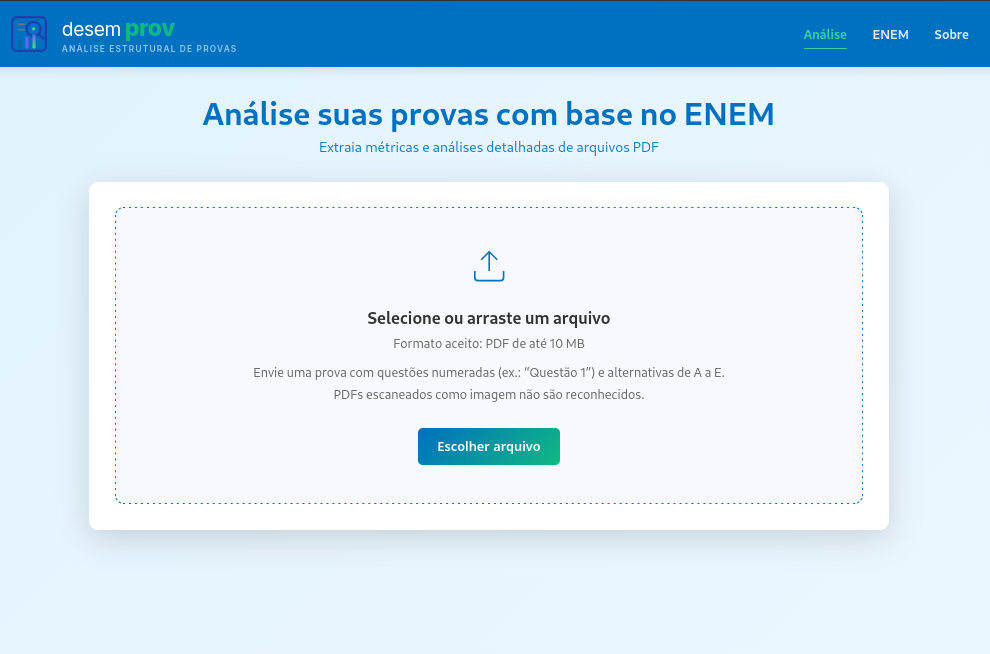

**Objetivo do usuário:** Anexar um arquivo na tela  
**Signos principais:** Prova, Área tracejada, ícone de upload (seta), texto instrucional, texto de restrição, botão "Escolher arquivo"  
**Origem no MoLIC:** M02/Enviar avaliação    

### F02 — Arquivo no formato válido enviado (fluxo feliz)

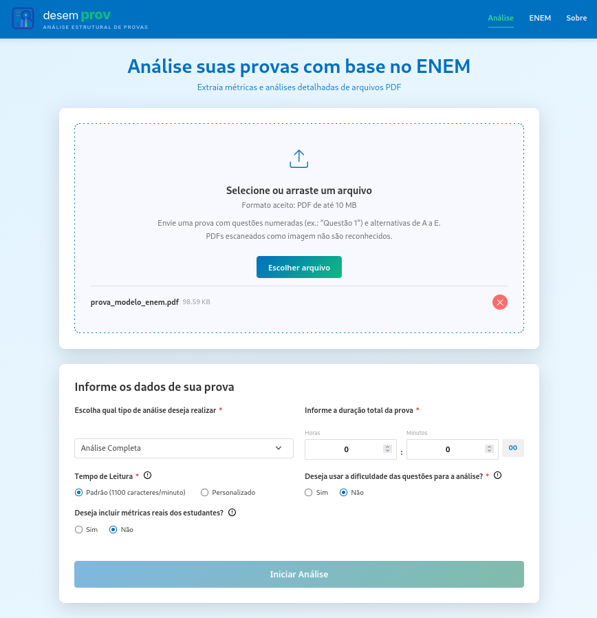

**Objetivo do usuário:** Seguir o fluxo e informar os dados da prova   
**Signos principais:** Informações do arquivo (nome e tamanho), botão "cancelar"   
**Origem no MoLIC:** M02/Carregar arquivo   

### F02E1 — Arquivo com formato inválido

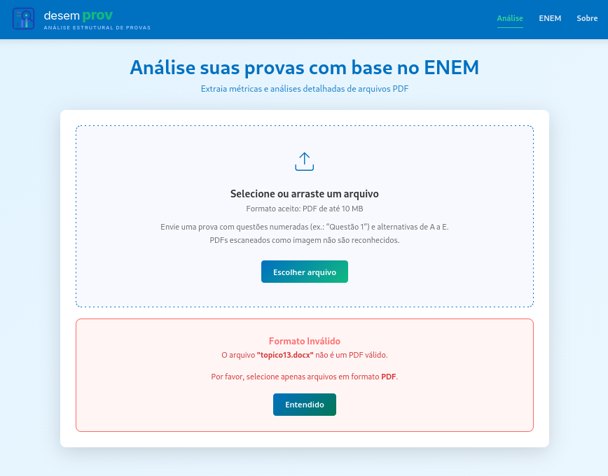

**Objetivo do usuário:** Enviar arquivo em formato válido    
**Signos principais:** Erro1: Formato inválido    
**Origem no MoLIC:** M02/cena de erro  

### F02E2 — Erro ao extrair questões do PDF

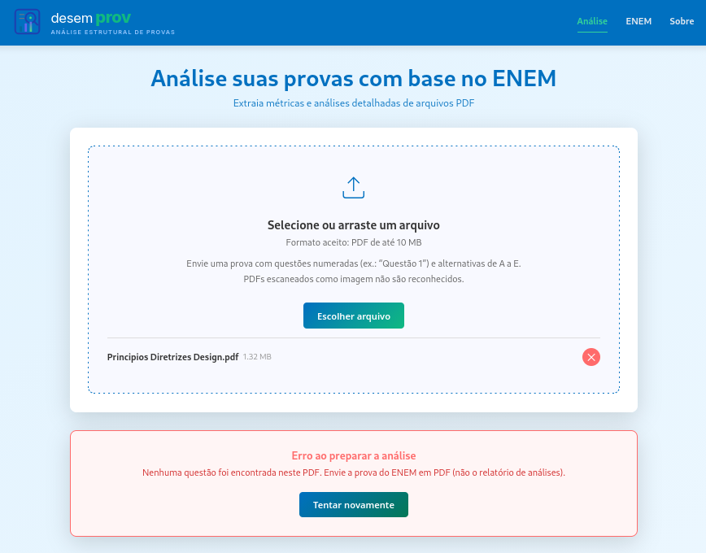

**Objetivo do usuário:** Enviar arquivo no qual questões consigam ser identificadas   
**Signos principais:** Erro2: Erro ao preparar a análise   
**Origem no MoLIC:** M02/cena de erro  

### F02E3 — Tamanho do arquivo excede limite 

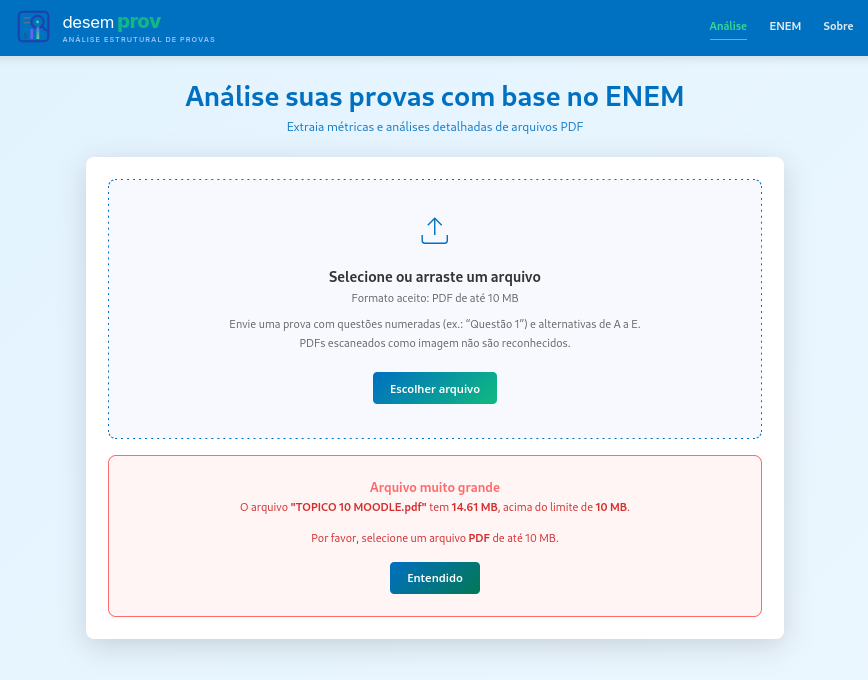

**Objetivo do usuário:** Enviar um arquivo dentro das limitações específicas para seguir o fluxo feliz de analisar sua avaliação   
**Signos principais:** Erro3: Arquivo excede tamanho   
**Origem no MoLIC:** M02/cena de erro  

### F02E4 — Erro interno

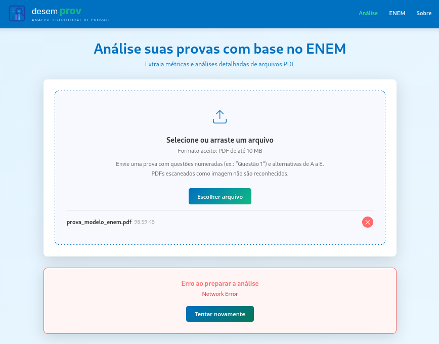

**Objetivo do usuário:** Conseguir prosseguir para a tela de informar os dados de sua prova   
**Signos principais:** Erro4: Server Error   
**Origem no MoLIC:** M02/cena de erro  

> Documente também estados que muitas equipes esquecem: carregamento, vazio, confirmação, sucesso, erro, permissão negada, cancelamento, desfazer/voltar quando aplicável.

### F03 — Todos os campos obrigatórios preenchidos (fluxo feliz)

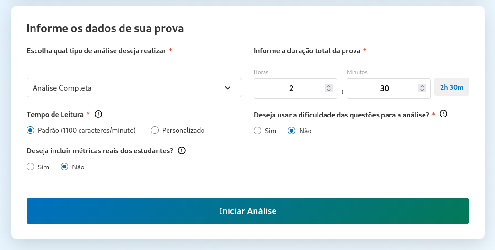

**Objetivo do usuário:** Seguir para a página das analises para ver os resultados  
**Signos principais:** duração da prova, tipo da analise, botão "Iniciar Análise"  
**Origem no MoLIC:** M01/cena de Informar dados da prova  

### F03E1 — Aviso de duração máxima inválida

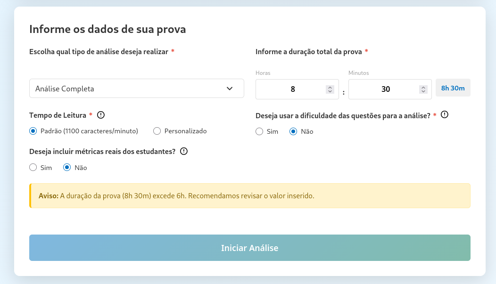

**Objetivo do usuário:** Mudar a duração da prova para não exceder o tempo máximo e conseguir prosseguir com a análise  
**Signos principais:** duração da prova, erro5: Erro ao colocar valor maior que 6h  
**Origem no MoLIC:** M01/cena de erro (erro 5) 

### F03.1 — Informações sobre os campos

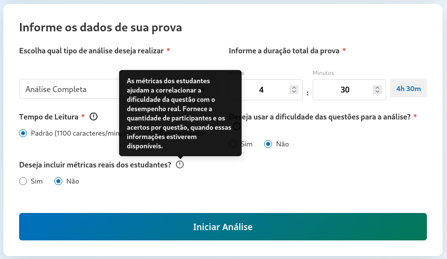

**Objetivo do usuário:** Entender melhor porque selecionar alguma opção  
**Signos principais:** ícone de ajuda contextual(i), balão de ajuda contextual(tooltip)  
**Origem no MoLIC:** M01/cena de Informação dos inputs 

### F03.2 — Informar tempo de leitura válido

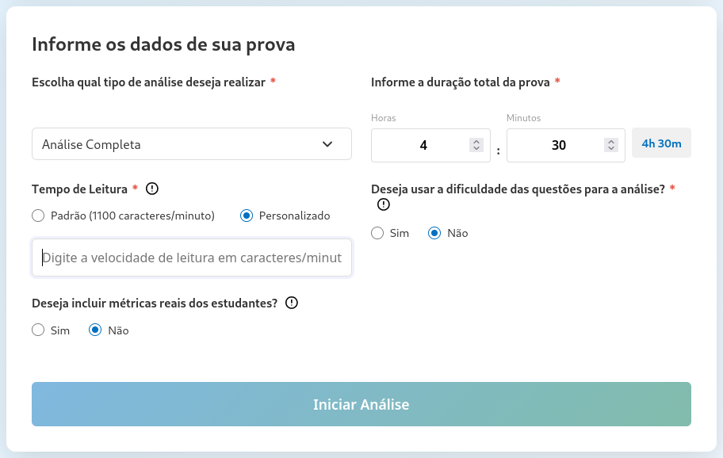

**Objetivo do usuário:** Quer utilizar outro tempo de leitura para a análise  
**Signos principais:** Opção do tempo de leitura, campo de velocidade de leitura  
**Origem no MoLIC:** M01/cena de Ajustar velocidade de leitura 

### F03.3 — Utilizar a dificuldade

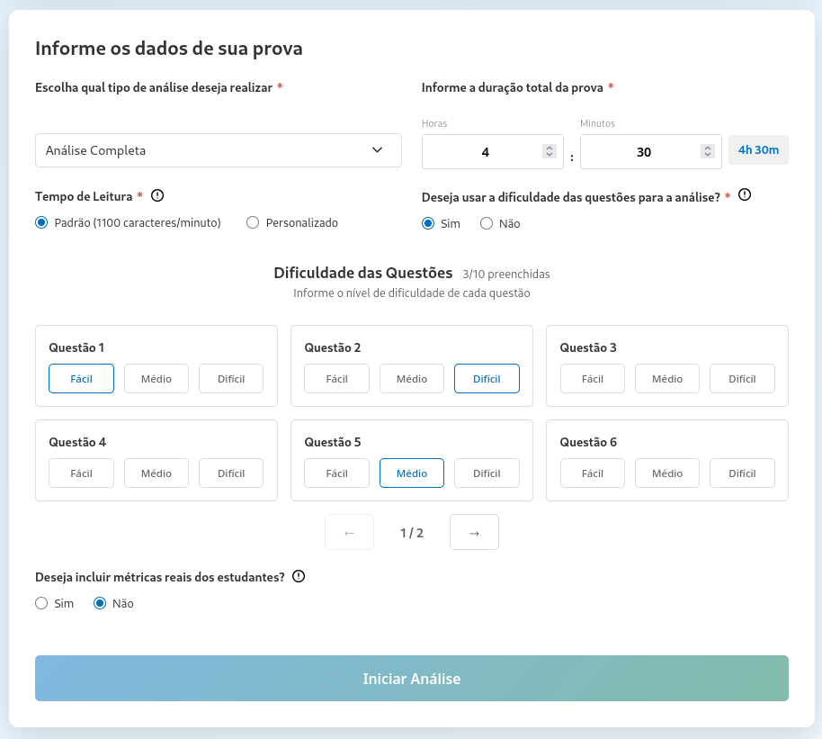

**Objetivo do usuário:** Deseja que a dificuldade das questões seja considerada na análise  
**Signos principais:** Opção de dificuldade das questões, dificuldade das questões  
**Origem no MoLIC:** M01/cena de Atribuir dificuldade das questões 

### F03.4 — Utilizar as métricas dos estudantes

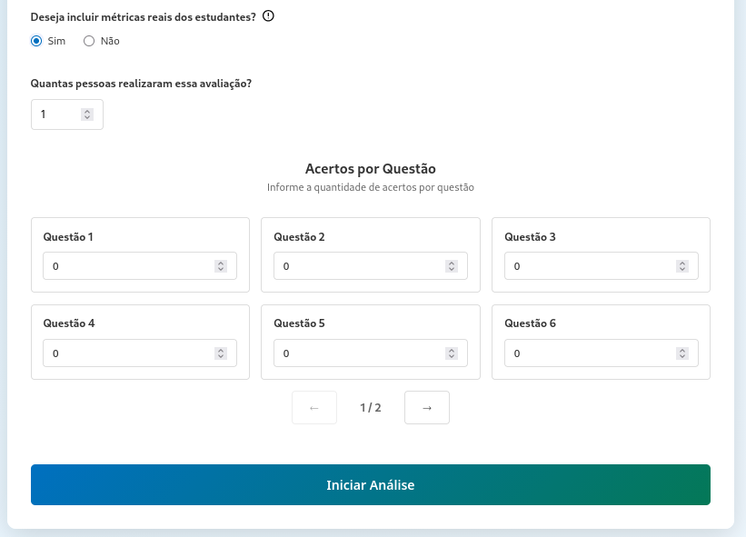

**Objetivo do usuário:** Deseja que a quantidade de alunos que acertou as questões seja considerado na análise  
**Signos principais:** opção de incluir métricas dos alunos, quantidade de participantes, acertos por questão  
**Origem no MoLIC:** M01/cena de Inserir acertos dos alunos 

## Sistema visual e consistência

| Elemento | Regra adotada | Justificativa |
|---|---|---|
| Tipografia | Fonte principal Inter (Google Fonts, pesos 400, 600, 700 e 800), usada no cabeçalho e nos logotipos. O corpo da página usa a pilha do sistema (-apple-system, Segoe UI, Roboto, sans-serif). Títulos de seção em 1.2rem, subtítulos e textos auxiliares em 0.9rem, rótulos e campos em 1rem. | A Inter é legível em telas e tem bom contraste em tamanhos pequenos. A pilha do sistema evita carregar fonte extra no corpo. Tamanhos em rem respeitam a configuração de texto do navegador.|
| Cores | azul primário `#0070C0`, verde de sucesso `#10B981`, amarelo de alerta `#F59E0B`, vermelho de erro `#EF4444`, cinzas `#1F2937`, `#6B7280` e `#F3F4F6`. Texto principal `#333`, secundário `#666`. Azul `#0070C0` para ações e ícones informativos; vermelho `#e74c3c` para o asterisco de campo obrigatório. | Escolhemos a paleta a partir do logo: azul `#0070C0` (fundo do cabeçalho) e verde `#10B981` (destaque de "prov"). Hierarquia: azul para ações principais e ícones informativos; texto `#333` para títulos e corpo; `#666` para apoio. Semântica fixa: verde = sucesso, amarelo = alerta, vermelho = erro. Texto escuro sobre branco garante contraste de 12,6:1 (`#333`) e 5,7:1 (`#666`), acima de 4,5:1. Para gráficos da análise buscamos permanecer dentro da paleta de cores, com excessão de algun gráficos para priorizar sua legibilidade.|
| Componentes | Cards brancos: os gráficos, as seções de análise e os formulários ficam em blocos com fundo branco sobre o fundo azul-claro da página. Botões de ação: "Filtro" tem borda e texto em azul `#0070C0`, fundo branco e hover em `#f0f7ff`; aparece no cabeçalho dos gráficos. "Exportar" usa o mesmo azul, inverte para fundo azul com texto branco no hover e fica com 50% de opacidade quando desabilitado; aparece no cabeçalho das páginas de resultados e de ENEM. Botões de ação ("Tentar novamente", "Analisar"...) são degrade de azul e verde. Ícone informativo: é um círculo com "!" em preto, usado ao lado dos rótulos dos campos e dos títulos dos gráficos. Ao passar o mouse, mostra um tooltip preto. | Os cards separam os blocos do fundo, os botões de ação ficam no cabeçalho, os filtros ficam posicionados sempre no canto direito bem como o "Exportar" e o ícone informativo aparecendo ao lado dos títulos. |
| Feedback | Usamos cor e texto juntos, nunca só a cor. Erro: vermelho, com fundo rosado `#fff5f5`, borda vermelha e texto vermelho escuro `#c0392b`, contraste de 5,1:1 (formato inválido, arquivo acima de 10 MB, falha de rede). Atenção: amarelo-âmbar, com fundo amarelo claro `#fff3cd`, borda âmbar `#ffc107` e texto marrom-oliva `#856404`, contraste de 5,0:1 (duração acima de 6h, dados faltando para a correlação). Sucesso: não há mensagem de sucesso no MVP, quando é sucesso apenas continua/habilita o fluxo feliz, o verde `#10B981` é usado na marca e nos gráficos, não como status. Os blocos têm título em negrito e, nos avisos, borda à esquerda. | Mantém o feedback compreensível sem depender só da cor, para usuários com daltonismo ou baixa visão. Os pares de texto escolhidos passam do mínimo de 4,5:1 do WCAG. |

<!--
Define como tornar a web mais acessivel para pessoas com deficiência

principios: 

1-perceptivel
2-operável
3-compreensivel
4-robusto
os critérios tem 3 níveis: A (mínimo), AA (padrão exigido pela maioria das leis e políticas) e AAA (máximo, nem sempre viável para todo o conteúdo).
 -->
## Verificação de acessibilidade básica

<!--Para produto Web, considere critérios pertinentes da WCAG vigente (por exemplo, contraste, foco, tamanho de alvo, texto alternativo e navegação por teclado quando aplicáveis). Para outras plataformas, use as recomendações adequadas ao contexto.-->

Para o protótipo web do desemprov, foram avaliados os seguintes critérios baseados nas diretrizes WCAG (nível AA):

- Contraste de Cores: A paleta de cores do sistema (fundo branco com textos em cinza escuro #333 e preto) foi validada para garantir que a leitura seja confortável. Os botões de ação (como "Escolher arquivo", "Tentar novamente", "Entendido") possuem contraste adequado entre o texto branco e o fundo colorido (azul/verde). Nos estados de erro (telas F02E1, F02E2, F02E3, F02E4), a cor vermelha não é usada sozinha; ela é acompanhada de títulos em negrito e texto explicativo, garantindo a compreensão para usuários com daltonismo. 
- Redimensionamento de Texto e Responsividade (Reflow): A interface foi construída para ser responsiva. É possível aplicar zoom elevado (acima de 200%) e a página continua legível, sem sobreposição de elementos ou perda de conteúdo. Os cards se ajustam à tela e as barras de rolagem horizontal são evitadas, garantindo que usuários com baixa visão possam ampliar os textos e gráficos sem quebrar o layout. 
- Tamanho do Alvo (Target Size): Os botões de ação primários e secundários (ex: "Escolher arquivo", "Entendido", "Filtro") possuem áreas de clique generosas, facilitando o toque em dispositivos móveis e o clique com usuários com limitações motoras. 
<!-- COMPLETAR COM TELAS LU E NUNO -->
- Navegação por Teclado e Foco: Os formulários (tela F02/F0xxxxxx - Informe os dados de sua prova) utilizam campos padrão de input (radio buttons, selects, inputs de texto), que recebem foco visível ao navegar com a tecla Tab. A área de drag-and-drop (arrastar e soltar) possui o botão "Escolher arquivo" como alternativa acessível para quem não consegue usar o mouse.Além dos campos em sua maioria já virem com valore default, facilitando a redução de movimentos desnecessários. 
- Texto Alternativo e Semântica: Ícones puramente visuais (como a seta de upload e o "X" de fechar/cancelar) contém rótulos ARIA (aria-label) para que leitores de tela os identifiquem (ex: "Ícone de upload", "Cancelar arquivo"). 
- Identificação de Erros (Feedback): Os erros de upload (formato inválido, tamanho excedido, PDF sem questões ou falha de rede) são apresentados de forma clara, informando exatamente o que aconteceu e oferecendo uma ação de recuperação imediata (botão "Tentar novamente" ou "Entendido"). 
- Gráficos e Resultados: Os gráficos da tela de resultados (Pizza, Barras, Dispersão) tem texto descritivos que auxiliam na interpretacao, bem como descrições e calculos utilizados nas tooltips, facilitando a leitura e comprensão.

## Checklist

- [ ] Link do Figma está acessível.
- [ ] Há screenshots representativos no repositório.
- [ ] Todos os MoLIC relevantes estão cobertos.
- [ ] Estados de erro, feedback e recuperação foram prototipados.
- [ ] Terminologia/signos são consistentes com Entrega 9.
- [ ] Componentes equivalentes se comportam de forma consistente.
- [ ] Fluxos críticos são clicáveis do início ao fim.
- [ ] O protótipo está pronto para inspeção e testes, sem “links mortos” nas tarefas avaliadas.
- [ ] Dashboards, relatórios, históricos, filtros, administração e CRUDs presentes possuem justificativa rastreável.
- [ ] Estados de vazio, processamento, erro e recuperação foram considerados quando pertinentes.
- [ ] Resultados técnicos são apresentados de forma interpretável para o perfil de usuário.
- [ ] A equipe distingue no protótipo o que é interação simulada e o que é funcionalidade técnica realmente integrada, quando necessário.
