# Entrega 13 — Avaliação de IHC por inspeção heurística

**Data:** 08/11/2026    
**Status:**  🟨 Em andamento   
**Responsabilidade:** 1 avaliação completa por integrante, sobre todas as telas/estados relevantes do projeto.  
<!--
criado p busc aproblema de usabilidade

1-criar fluxograma pra se tiver q desenha flux ode valaicao heruistica esses sao os passos, quantas vezes repete cad aum...

PASSO A PASSO DA HERUSTICA: FLUXOGRAMA Q CRIAREMOS 9anotacao topico 13)

Metodo baseado em inspecao, que mfaz inspeco somos nos especialistas 

todo metodo de avalaicao é baseado em 
-prearacao
-coleta de dados
-interpretacao
-consolidacao
-relato dos resultados

Teste de usabilidade nao tem usuario, é so especialista, pego heuristicas (regras parecidas com diretrizes) e do ranking dd atrnedimento ou n (ranking de violacao), indico quem violou  

No mercado indciamos violacoes 

Na entrega do plinio: avlaiamos interface fazendo relatorio de heuristica, nos como especialsitas avaliando heuristica, indicando onde violou ex se tela violou todas as heuristics tenho exemplo de violacao, se nao tive violacao heuristica n estudo baseado em nd pq nao violei. 

Ai pro plinio indico oq nao violei, oq foi atendido na avlaaicao heuristica 

Avalaicao heuristica de mercado mostra oq a pessoa violou e qual o prejuizo, impacto daquela violacao 

Pra disciplina coloca tb oq fizemos de bom 

Prototipo uso p avaliacao herusitica e teste de obs de usuario  

No mercado n faco avaliacao heurstica cm msm equipe q fez software pq tem regra de pricnipios de design e vo ve se desrregulou esses principios  
-->
## Objetivo da atividade

Encontrar problemas de usabilidade por inspeção sistemática da interface com as **10 heurísticas de Nielsen**. Cada avaliador trabalha individualmente primeiro; depois a equipe consolida problemas duplicados e prioridades.

> **Parte de violações:** registre somente problemas reais. Não invente uma violação para “preencher” cada heurística. Para provar que todas foram exercitadas, use a **matriz de cobertura H1–H10**. Para heurísticas sem violação, a disciplina solicita um exemplo didático de boa prática.

## 1. Heurísticas adotadas

1. Visibilidade do status do sistema
2. Compatibilidade entre o sistema e o mundo real
3. Controle e liberdade do usuário
4. Consistência e padrões
5. Prevenção de erros
6. Reconhecimento em vez de memorização
7. Flexibilidade e eficiência de uso
8. Estética e design minimalista
9. Ajudar usuários a reconhecer, diagnosticar e recuperar-se de erros
10. Ajuda e documentação

## Cobertura especial para interfaces administrativas e analíticas

Quando existirem, não limite a avaliação às “telas principais”. Inspecione também:

- dashboard em estados normal, vazio e erro;
- filtros sem resultado e filtros combinados;
- relatórios e exportação;
- histórico/listas longas;
- formulários CRUD (criação, edição, exclusão, validação);
- alteração de perfil/permissão;
- confirmações de ações destrutivas;
- processamento/loading/progresso;
- falha e recuperação;
- comparação de resultados;
- mensagens de termos técnicos, métricas e recomendações;
- ajuda/documentação contextual.

Em TCCs técnicos, observe especialmente se a interface comunica o estado do processamento e traduz informações técnicas para o vocabulário do usuário escolhido.

## 2. Escopo da inspeção

| Item | Definição |
|---|---|
| Versão avaliada | verão atual do código disponível em: [Repositório TCC](https://github.com/beatrizmanaia26/TCC-DesempenhoEnem) |
| Telas/estados | f01,f02,f02e1,f02e2,f02e3,f02e4,f03,f03_1,f03_2,f03_3, f03_4,f03e1, f04,f04_1,f04_2,f04_3,F04_4,F04e1,f04e2 |
| Fluxos | M01/M02/M03 |
| Dispositivo/viewport | Notebook |
| Avaliadores | Beatriz Manaia Lourenço Berto, Luana Bortko Rodrigues, Nuno Martins Guilhermino da Silva |

## 3. Procedimento individual

Cada avaliador deve:

1. percorrer os fluxos/telas ao menos uma vez para familiarização;
2. inspecionar novamente aplicando sistematicamente H1–H10;
3. registrar cada problema com evidência e contexto;
4. atribuir severidade **depois de compreender bem o problema**, justificando a decisão;
5. não discutir achados com os demais antes de terminar a inspeção individual, quando o objetivo for preservar independência.

### Escala de severidade (0–4)

| Grau | Interpretação |
|---:|---|
| 0 | não é considerado problema de usabilidade |
| 1 | problema cosmético; corrigir se houver tempo |
| 2 | problema menor; baixa prioridade |
| 3 | problema maior; alta prioridade |
| 4 | catástrofe de usabilidade; correção imperativa antes de disponibilizar |

Ao justificar, considere **frequência, impacto e persistência** do problema no contexto real de uso.

---

## Avaliador A01 — Beatriz Manaia Lourenço Berto

### 4. Matriz de cobertura das 10 heurísticas

<!--
H1: visibilidade do estado d osistema: o sistema deve sempre manter os usuários informados sobre o que está acontecendo atraves de feedback (respsota às ações do usuário) adequado e no tempo certo

H2: correspondência entre o sistema e o mundo real: o sistema deve utilizar palavras, expressões e conceitos que são familiares aos usuários, em vez de utilizar termos orientados ao sistema ou jargão dos desenvolvedores. O designer deve seguir as convenções do mundo real, fazendo com que a informação apareça em uma ordem natural e lógica, conforme esperado pelos usuários

H3: controle e liberdade do usuário: os usuários frequentemente realizam acoes equivocadas no sistema e precisam de uma "saida de emergencia"claramente marcada para sair do estado indesejado sem ter que percorrer um dialogo extenso. A interface deve permitir que o ususario desfaca e refação suas acoes 

H4: consistencia e padronizacao: os usuários nao devem ter de se perguntar se palavras, situacoes ou acoes diferentes significam a mesma coisa. O designer deve seguir as convencoes da plataforma ou do ambiente computacional

H5: reconhecimento em vez de memorizacao: o desginer deve tornar os objetivos, as acoes e opcoes visiveis. As instrucoes de uso do sistema devem estar visiveis ou facilmente acessiveis sempre que necessário 

H6: flexibilidade e eficiencia de uso: aceleradores podem tornar a interacao do usuario mais rapida e eficiente, permitindo que o sistrema consiga servir igualmemte bem os usuarios experientes e inexperientes

H7: projeto estético e minimalista: a interface nao deve conter informacao que seja irrelevante ou raramente necessária. Cada unidade extra de informacao em uma interface reduz sua visiibilidade relativa, pois compete com as demais unidades de informacao pela atencao do usuário

H8: prevencao de erros: melhor do que uma boa mensagem de erro é um projeto cuidadoso que evite que um problema ocorra, caso isso seja possivel

H9: ajude os usuarios a reconhecerem, diagnosticarem e se recuperarem de erros: as mensagem de erro devem ser expressas em linguagem simples (sem codigos indecifraveis), indicar precisamente o problema e sugerir uma solucao de forma construtiva

H10: ajuda e documentacao: é necessario oferecer ajuda e documentacao de alta qualidade. Tais informacoes devem ser facilmente encontradas, focadas na tarefa do usuario, enumerar passos concretos a serem realizados e nao ser muito extensas

 -->

| Heurística | Telas/fluxos examinados | Houve violação? | IDs dos achados | Exemplo de boa prática se não violada |
|---|---|---|---|---|
| H1 | f01,f02,f02e1,f02e2,f02e3,f02e4,f03,f03_1,f03_2,f03_3, f03_4,f03e1, f04,f04_1,f04_2,f04_3,F04_4,F04e1,f04e2 | não | f02, f02e1, f02e2, f03e3, f04e4 | Há informações das métricas em tooltips, aviso de todos os erros que ocorrem com explicação de como arrumar, informação de como preencher um campo, entre outros |
| H2 | f01,f02,f02e1,f02e2,f02e3,f02e4,f03,f03_1,f03_2,f03_3, f03_4,f03e1, f04,f04_1,f04_2,f04_3,F04_4,F04e1,f04e2 | sim | V01 | Apesar das falhas, outros termos que podem não ser muito conhecidos como "correlação" "valores p", "holm" aparecem porem sempre com uma explicação de seu contexto/aplicação, além de terem links que redirecionam o usuário a um site explicativo. |
| H3 | f01,f02,f02e1,f02e2,f02e3,f02e4,f03,f03_1,f03_2,f03_3, f03_4,f03e1, f04,f04_1,f04_2,f04_3,F04_4,F04e1,f04e2 | não |f02, f02e1, f02e2, f03e3, f04e4, f03_2, f04_2 | todas as ações do usuário podem ser refeitas/desfeitas, desde o arquivo anexado, filtro aplicado a valor inserido, além de termos acessos ubiquos na navbar. |
| H4 | f01,f02,f02e1,f02e2,f02e3,f02e4,f03,f03_1,f03_2,f03_3, f03_4,f03e1, f04,f04_1,f04_2,f04_3,F04_4,F04e1,f04e2 | sim | V02 | Apesar da inconsistência em "entendi" e "tentar novamente" nas telas de erro, utilizamos as mesmas palavras ao inves de sinônimos, mantemos convenções e padrões entre as telas tanto de palavras, consistência de valores quanto cores |
| H5 | f01,f02,f02e1,f02e2,f02e3,f02e4,f03,f03_1,f03_2,f03_3, f03_4,f03e1, f04,f04_1,f04_2,f04_3,F04_4,F04e1,f04e2 | não | f01,f02e1, f02e2, f03e3, f04e4, f03)2, f03_3, f03_4, f04, f04_3 | Sempre informamos os usuários de conteúdos que ele precisa saber, seja para preencher os campos de input ou para compreender melhor as anaálises, fazemos isso por meio de tooltips e de marcadores de inputs preenchidos, por exemplo. |
| H6 | f01,f02,f02e1,f02e2,f02e3,f02e4,f03,f03_1,f03_2,f03_3, f03_4,f03e1, f04,f04_1,f04_2,f04_3,F04_4,F04e1,f04e2| não | f03_3,f03_4,f03e2,f04_2,  | Garantimos isso permitindo que usuário nevegue pela aplicação por meio da tecla tab, bem como preencha campos numéricoms aumentando o numero com a seta ou digitando, também mantemos a persistnecia dos dados e filtros entre as telas e permitimos que filtros sejam alterados sem reiniciar a análise |
| H7 | f01,f02,f02e1,f02e2,f02e3,f02e4,f03,f03_1,f03_2,f03_3, f03_4,f03e1, f04,f04_1,f04_2,f04_3,F04_4,F04e1,f04e2 | não | 01,f02,f02e1,f02e2,f02e3,f02e4,f03,f03_1,f03_2,f03_3, f03_4,f03e1, f04,f04_1,f04_2,f04_3,F04_4,F04e1,f04e2 | Apesar de haver uma grande quantidade de texto para as métricas, eles são necessários para compreender o que é analisado e do que os gráficos se tratam.Assim, tornamos a interface o mais minimalista possível.  |
| H8 | f01,f02,f02e1,f02e2,f02e3,f02e4,f03,f03_1,f03_2,f03_3, f03_4,f03e1, f04,f04_1,f04_2,f04_3,F04_4,F04e1,f04e2 | não | f01,f02, f03_2,f04_1 | Todos os possíveis erros são informados tanto visualmente quanto textualmente de uma maneira bem clara onde mencionamos o problema e como arrumá-lo |
| H9 | f01,f02,f02e1,f02e2,f02e3,f02e4,f03,f03_1,f03_2,f03_3, f03_4,f03e1, f04,f04_1,f04_2,f04_3,F04_4,F04e1,f04e2 | não | f02e1, f02e2, f02e3, f02e4,f03e1 |Todos os possíveis erros são informados tanto visualmente quanto textualmente de uma maneira bem clara onde mencionamos o problema e como arrumá-lo, trazendo eles de uma forma compreensível |
| H10 | f01,f02,f02e1,f02e2,f02e3,f02e4,f03,f03_1,f03_2,f03_3, f03_4,f03e1, f04,f04_1,f04_2,f04_3,F04_4,F04e1,f04e2,f04e1,f04e2 | não | f01, 02e1, f02e2, f02e3, f02e4,f03e1,f04_3| Fornecemos ajuda e documentação para os conceitos que consideramos ser mais distantes de alguns docentes por meio de tooltips descritivas, explicação de como realizamos os cálculos e links para tópicos que os usuários podem não conhecer, como correlação, modelo logístico  |

### 5. Declaração de violações

| ID | Heurística | Tela/estado | Problema observado | Evidência | Severidade | Justificativa da severidade | Recomendação |
|---|---|---|---|---|---:|---|---|
| V01 | H2 | f04_3, f03_1, f04_2, f4 | algumas palavras e expressões não apresentam explicações claras sobre o que representam, podendo gerar dúvidas ou interpretações equivocadas por parte dos usuários. Por exemplo, não há uma definição do que é considerado um “texto introdutório”. Além disso, alguns tooltips utilizam siglas pouco conhecidas, como “IQR”, sem apresentar seus significados, o que pode dificultar a compreensão das informações. | 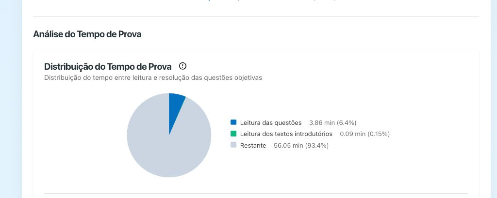,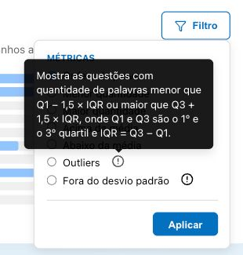 | 3 | ocorre sempre que as análises são carregadas, podendo dificultar um pouco na interpretsção correto das analises por parte do usuárioe influenciar negativamente sua compreensão. | adicinar na toolti uma explicação mais explicita do que são esses cocneitos (IQR e texto introdutório) que ficaram um pouco vagos |
| V02 | H4 | f02e1, f02e2, f02e3, f02e4 | nas telas de erro há uma incosist6encia entre a recuperação, em algumas oferecemos o botão "entendido" enquanto em outras aparece o botão "tentar novamente" | 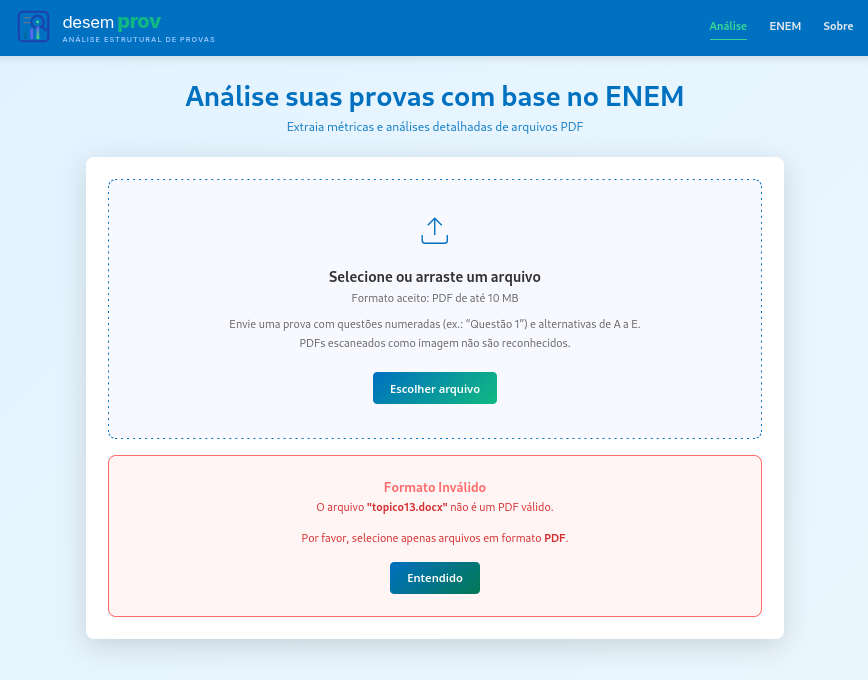,,,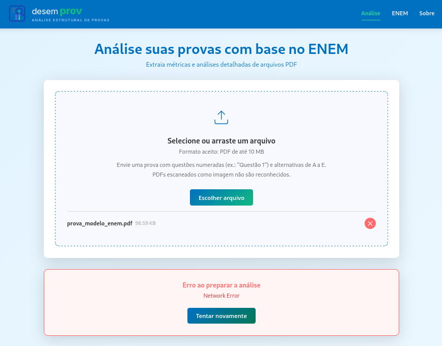 | 2 | Ocorre sempre que da algum dos 4 erros mencionados, a inconsistência está na comparação deles, impacto baixo pois usuário consegue arrumar o erro apesar disso | padronizar todos os botões de erro para "Tentar novamente" |

**Qualidade do relato:** o problema deve ser observável e localizado. Evite “interface confusa” sem dizer **o que**, **onde**, **quando** e **para quem**.

### 6. Boas práticas — heurísticas não violadas (atividade didática)

| Heurística sem violação | Exemplo no sistema | Evidência | Por que atende |
|---|---|---|---|
| H1 | informamos o usuário da análise sendo carregada, dos erros, das questões com dificuldade preenchida, se o tempo preenchido ultrapassa o limite, o motivo de algum gráfico não aparecer | 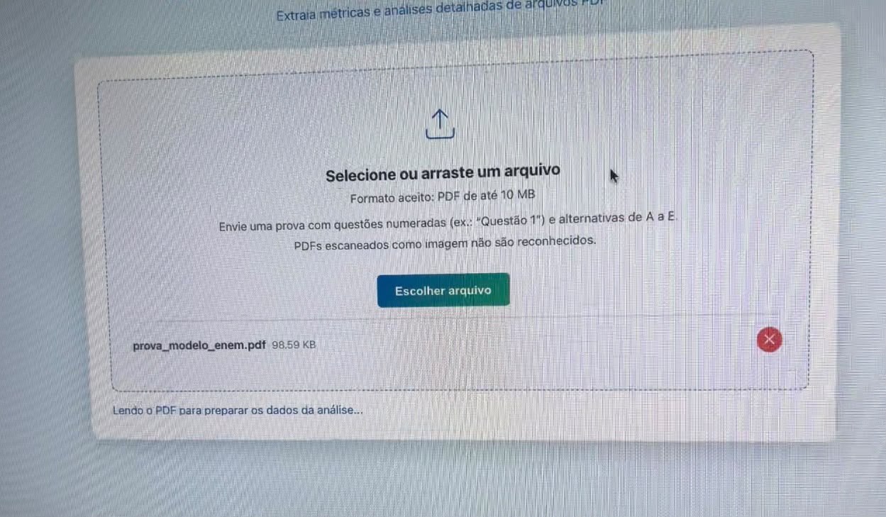, ,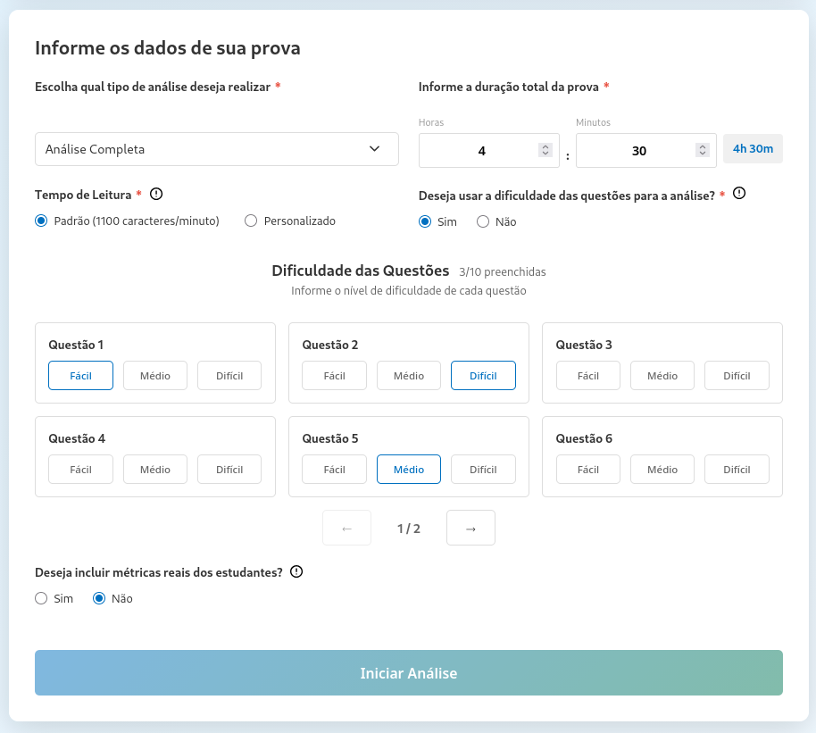,, 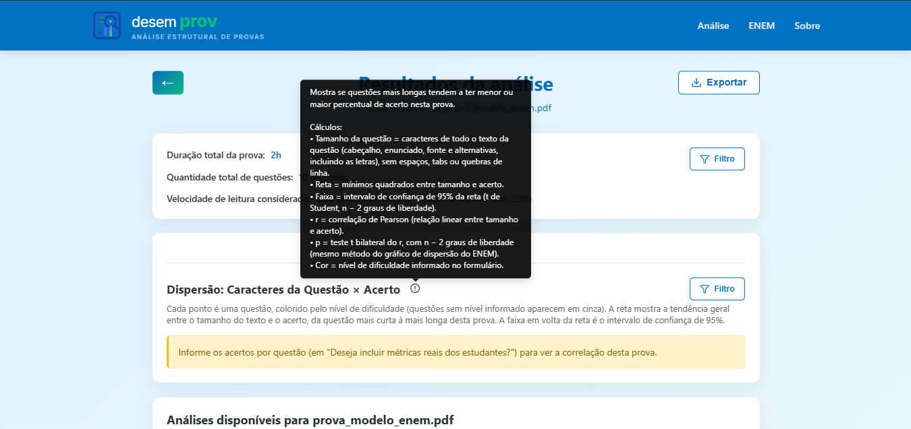, | pois o sistema mantém o usuário informado sobre o que está acontecendo durante sua interação, fornecendo feedbacks claros em momentos adequados, isso ocorre por meio de mensagens que indicam o carregamento da análise, notificações de erro, entre outros. Assim, o usuário consegue acompanhar o estado atual do sistema, compreender os resultados de suas ações e identificar possíveis problemas sem ficar sem orientação |
| H3 | telas de erro com opções de clicar em botões para cancelar ou alterar sua ação, ou seguir as informaçÕes de como resolver o problema, ubiquidade da navbar permitindo voltar a telas, presenta da seta "<-" para retornar a momentos anteriores, ao realizar uma ação, o meio (botão ou input) qe te levou ao novo estado permanece lá permitindo que volte/mude de ideia | 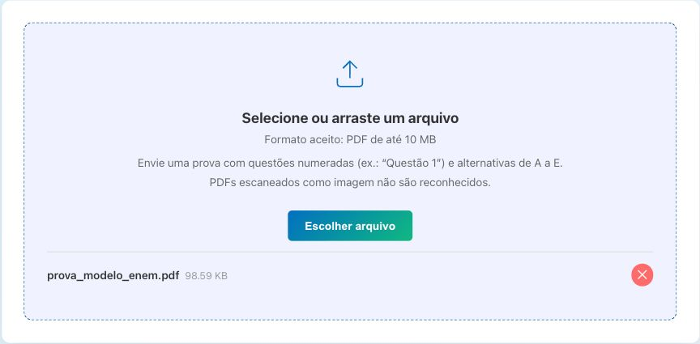, 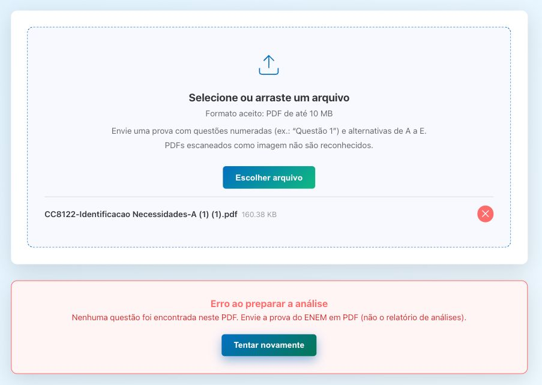,, 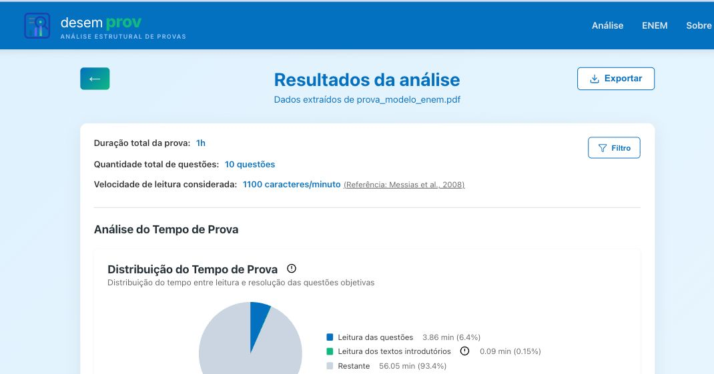, 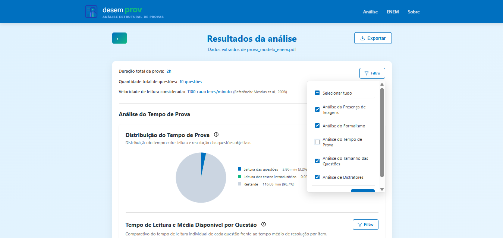 | Atende à heurística porque oferece ao usuário controle sobre suas ações, permitindo cancelar, alterar ou desfazer operações quando necessário. Isso é evidenciado pela presença de botões que possibilitam retornar de situações de erro, orientações para corrigir problemas, opções de navegação pela barra de menu e setas para voltar a etapas anteriores, dentre outras coisas. Dessa forma, o sistema oferece alternativas para sair de situações indesejadas sem exigir que o usuário reinicie todo o processo. |
| H5 | Sempre informamos os usuários de conteúdos que ele precisa saber, seja para fazer o upload do arquivo válido, preencher os campos de input ou para compreender melhor as anaálises, compreender os gráficos de maneira mais básica ou detalhada por tooltips, ou fornecer opçoes de filtro e exportação lembrando ele dessas opções | 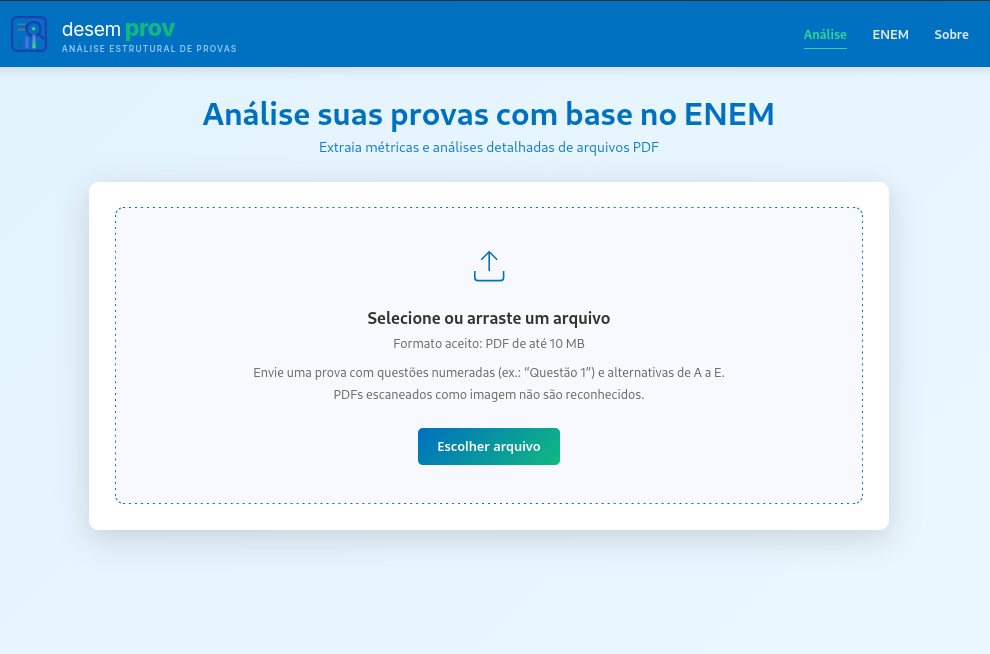, , 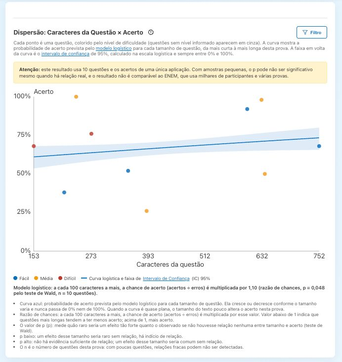, ,, | Atende à heurística porque disponibiliza informações e orientações diretamente na interface, evitando que o usuário precise memorizar instruções ou recorrer à própria memória para realizar as tarefas. Isso ocorre por meio de orientações sobre o formato correto do arquivo para upload, instruções para o preenchimento dos campos, textos explicativos que auxiliam na compreensão das análises e tooltips que oferecem explicações adicionais sobre os gráficos e suas métricas. Além disso, as opções de filtragem e exportação são sinalizadas na interface, facilitando sua identificação e utilização. Dessa forma, o sistema mantém as informações, ações e opções relevantes visíveis ou facilmente acessíveis sempre que necessário. |
| H6 | Garantimos isso permitindo que usuário nevegue pela aplicação por meio da tecla tab, bem como preencha campos numéricoms aumentando o numero com a seta ou digitando,também mantemos a persistnecia dos dados e filtros entre as telas e permitimos que filtros sejam alterados sem reiniciar a análise | 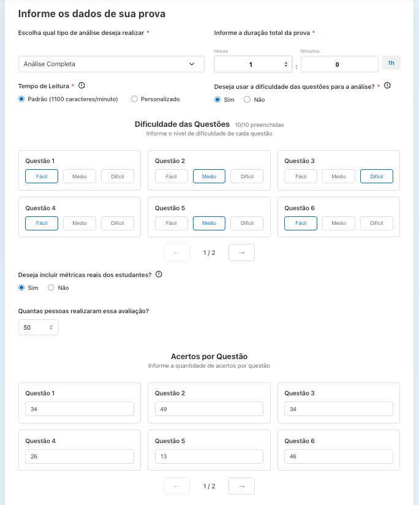, ,| Atende à heurística porque oferece diferentes formas de interação que tornam o uso do sistema mais rápido e eficiente, respeitando as preferências dos usuários. Isso é evidenciado pela possibilidade de navegar entre os elementos da interface utilizando a tecla Tab, sem depender exclusivamente do mouse, e pela facilidade de preenchimento dos campos numéricos, que podem ser editados tanto pela digitação direta quanto pelas setas de incremento e decremento. Além disso, o sistema permite alterar filtros sem precisar reiniciar toda a análise e mantém os dados preenchidos e os filtros aplicados mesmo quando o usuário navega entre diferentes telas. Dessa forma, evita retrabalho, reduz etapas desnecessárias e oferece uma experiência mais flexível e eficiente para usuários com diferentes níveis de familiaridade com a aplicação. |
| H7 | Todos os textos que estão sempre visíveis são necesários para o uso correto do sistema, incluíndo descrição das características necessárias para o upload de um arquivo, informações dos input e textos descritivos sobre os gráficos/métricas, uso de tooltip para disponibilizar explicações complementares sem ocupar espaço permanente na interface| , , 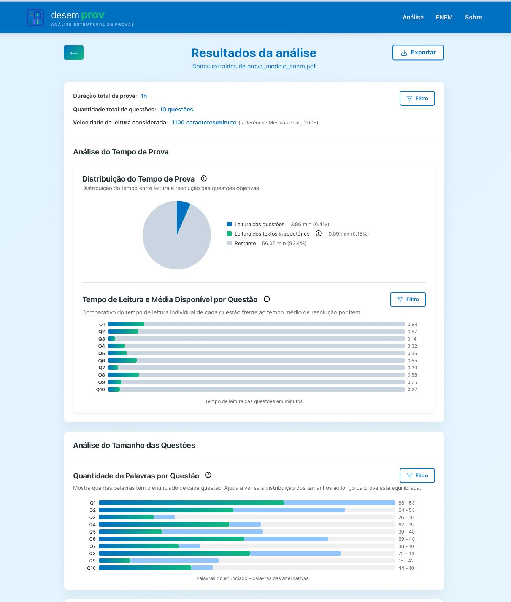,, , | Atende à heurística porque as informações apresentadas na interface possuem finalidade direta de orientar o usuário e facilitar a compreensão e a utilização do sistema. Os textos sobre os requisitos para upload, as instruções de preenchimento dos campos e as descrições dos gráficos e métricas são necessários para que o usuário compreenda quais dados deve fornecer e como interpretar os resultados apresentados. Embora algumas análises exijam textos explicativos mais extensos, eles são relevantes para evitar interpretações equivocadas. Além disso, utilizamos tooltips para disponibilizar explicações complementares sem ocupar espaço permanente na interface. Dessa forma, buscamos manter a interface objetiva e organizada, apresentando informações relevantes sem adicionar elementos desnecessários que possam comprometer a visibilidade dos conteúdos principais. |
| H8 | Todos os possíveis erros são informados tanto visualmente quanto textualmente de uma maneira bem clara onde mencionamos o problema e como arrumá-lo, seja os erros do upload, warning de input ou erros de gráfico | , , , , ,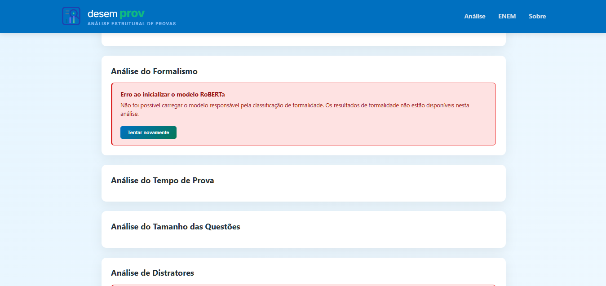, 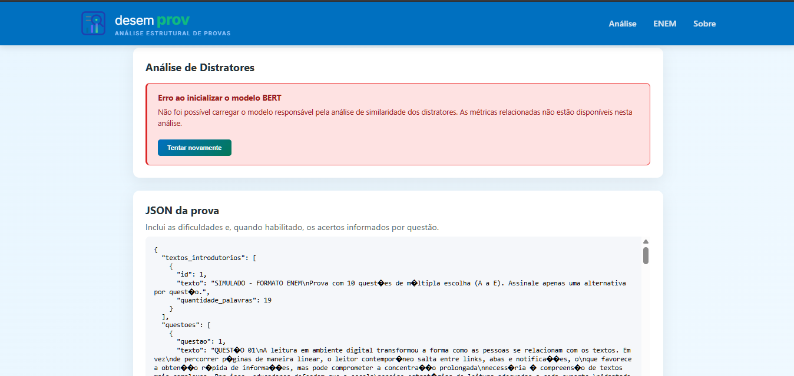, ,| Atende à heurística porque o sistema adota mecanismos para evitar que erros ocorram durante a utilização, orientando o usuário antes e durante a realização das ações. Isso é evidenciado pelas indicações dos formatos e requisitos necessários para o upload de arquivos, pelos avisos nos campos de entrada quando valores inválidos ou fora dos limites são identificados e pelas validações que impedem o processamento de informações inadequadas. Quando um problema ocorre, o sistema também apresenta mensagens claras, tanto visualmente quanto textualmente, identificando sua causa e orientando o usuário sobre como corrigi-lo. Além disso, são apresentados avisos quando determinadas condições impedem a exibição de gráficos. Dessa forma, o sistema busca prevenir erros sempre que possível e facilitar sua identificação e correção quando ocorrem. |
| H9 | Todos os possíveis erros são informados tanto visualmente quanto textualmente de uma maneira bem clara onde mencionamos o problema e como arrumá-lo, trazendo eles de uma forma compreensível,eja os erros do upload, warning de input ou erros de gráfico | , , , , ,, , , | Atende à heurística porque as mensagens de erro são apresentadas em linguagem clara e compreensível, evitando termos técnicos excessivos ou informações que dificultem o entendimento do usuário. Quando ocorre algum problema, o sistema identifica o que está errado, explica sua possível causa e apresenta orientações sobre como solucioná-lo. Isso é evidenciado pelas mensagens relacionadas ao upload de arquivos, pelos avisos de preenchimento dos campos e pelas notificações sobre problemas que impedem a geração ou exibição de determinados gráficos. Dessa forma, o usuário consegue reconhecer o erro, compreender o que o ocasionou e identificar quais ações deve realizar para corrigi-lo, sem depender de conhecimentos técnicos específicos. |
| H10 | Fornecemos ajuda e documentação para os conceitos que consideramos ser mais distantes de alguns docentes por meio de tooltips descritivas, explicação de como realizamos os cálculos e links para tópicos que os usuários podem não conhecer, como correlação, modelo logístico, tanto na tela de preenchimento de input quanto na visuliazação dos gráficos. | 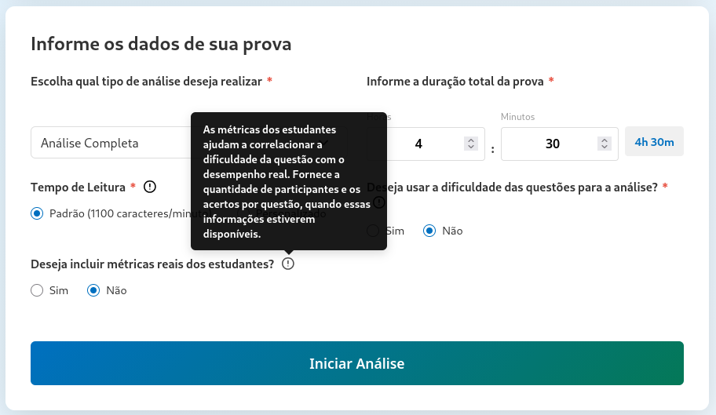, , , , , , | Atende à heurística porque o sistema disponibiliza recursos de ajuda e documentação contextualizados, facilmente acessíveis durante a realização das tarefas. Por meio de tooltips descritivas, explicações sobre os cálculos realizados e links para conteúdos complementares, oferecemos suporte aos docentes na compreensão de conceitos que podem não ser familiares, como correlação e modelo logístico. Essas orientações estão presentes tanto nas telas de preenchimento dos campos quanto na visualização dos gráficos e análises, permitindo que o usuário consulte as explicações conforme sua necessidade, sem precisar interromper sua atividade ou buscar informações externas. Dessa forma, a documentação é apresentada de maneira contextualizada e direcionada às dúvidas que podem surgir durante o uso do sistema. |

## Avaliador A02 — Luana Bortko Rodrigues

### 4. Matriz de cobertura das 10 heurísticas
<!--
H1: visibilidade do estado d osistema: o sistema deve sempre manter os usuários informados sobre o que está acontecendo atraves de feedback (respsota às ações do usuário) adequado e no tempo certo

H2: correspondência entre o sistema e o mundo real: o sistema deve utilizar palavras, expressões e conceitos que são familiares aos usuários, em vez de utilizar termos orientados ao sistema ou jargão dos desenvolvedores. O designer deve seguir as convenções do mundo real, fazendo com que a informação apareça em uma ordem natural e lógica, conforme esperado pelos usuários

H3: controle e liberdade do usuário: os usuários frequentemente realizam acoes equivocadas no sistema e precisam de uma "saida de emergencia"claramente marcada para sair do estado indesejado sem ter que percorrer um dialogo extenso. A interface deve permitir que o ususario desfaca e refação suas acoes 

H4: consistencia e padronizacao: os usuários nao devem ter de se perguntar se palavras, situacoes ou acoes diferentes significam a mesma coisa. O designer deve seguir as convencoes da plataforma ou do ambiente computacional

H5: reconhecimento em vez de memorizacao: o desginer deve tornar os objetivos, as acoes e opcoes visiveis. As instrucoes de uso do sistema devem estar visiveis ou facilmente acessiveis sempre que necessário 

H6: flexibilidade e eficiencia de uso: aceleradores podem tornar a interacao do usuario mais rapida e eficiente, permitindo que o sistrema consiga servir igualmemte bem os usuarios experientes e inexperientes

H7: projeto estético e minimalista: a interface nao deve conter informacao que seja irrelevante ou raramente necessária. Cada unidade extra de informacao em uma interface reduz sua visiibilidade relativa, pois compete com as demais unidades de informacao pela atencao do usuário

H8: prevencao de erros: melhor do que uma boa mensagem de erro é um projeto cuidadoso que evite que um problema ocorra, caso isso seja possivel

H9: ajude os usuarios a reconhecerem, diagnosticarem e se recuperarem de erros: as mensagem de erro devem ser expressas em linguagem simples (sem codigos indecifraveis), indicar precisamente o problema e sugerir uma solucao de forma construtiva

H10: ajuda e documentacao: é necessario oferecer ajuda e documentacao de alta qualidade. Tais informacoes devem ser facilmente encontradas, focadas na tarefa do usuario, enumerar passos concretos a serem realizados e nao ser muito extensas

 -->

| Heurística | Telas/fluxos examinados | Houve violação? | IDs dos achados | Exemplo de boa prática se não violada |
|---|---|---|---|---|
| H1 | f01,f02,f02e1,f02e2,f02e3,f02e4,f03,f03_1,f03_2,f03_3, f03_4,f03e1, f04,f04_1,f04_2,f04_3,F04_4,F04e1,f04e2 | não | f02e1, f02e2, f02e3, f02e4 f03e1, f03 | O sistema tem alertas visiveis e que informam o erro e oque fazer quando ele acontece; Sistema avisa na tela dos inputs quando é possivel iniciar a analise (estado do botão) |
| H2 | f01,f02,f02e1,f02e2,f02e3,f02e4,f03,f03_1,f03_2,f03_3, f03_4,f03e1, f04,f04_1,f04_2,f04_3,F04_4,F04e1,f04e2 | sim | V1 | Tooltips que informam de forma clara e simples as informações |
| H3 | f01,f02,f02e1,f02e2,f02e3,f02e4,f03,f03_1,f03_2,f03_3, f03_4,f03e1, f04,f04_1,f04_2,f04_3,F04_4,F04e1,f04e2 | não | f02e1, f02e2, f02e3, f02e4 | O usuário não fica preso no sistema, ele fornece a possibilidade do usuario refazer suas ações |
| H4 | f01,f02,f02e1,f02e2,f02e3,f02e4,f03,f03_1,f03_2,f03_3, f03_4,f03e1, f04,f04_1,f04_2,f04_3,F04_4,F04e1,f04e2 | não | todas as telas | Há consistencia entre os componentes do sistema (padronização) |
| H5 | f01,f02,f02e1,f02e2,f02e3,f02e4,f03,f03_1,f03_2,f03_3, f03_4,f03e1, f04,f04_1,f04_2,f04_3,F04_4,F04e1,f04e2 | não | todas as telas | Sempre é mostrado ao usuário oque ele deve/pode fazer, exemplo são as instruçoes nos inputs, com os i's de informação e as indicações como quantas questões faltam para preencher a dificuldade de todas as questões |
| H6 | f01,f02,f02e1,f02e2,f02e3,f02e4,f03,f03_1,f03_2,f03_3, f03_4,f03e1, f04,f04_1,f04_2,f04_3,F04_4,F04e1,f04e2 | não | todas as telas | Damos bastante flexibidade para o usuário, como por exemplo poder escrever ou ir pelas setas em campos numéricos, a possibilidade de navegar com a tecla tab  |
| H7 | f01,f02,f02e1,f02e2,f02e3,f02e4,f03,f03_1,f03_2,f03_3, f03_4,f03e1, f04,f04_1,f04_2,f04_3,F04_4,F04e1,f04e2 | não | todas as telas | Só mostramos na tela informações realmente relevantes/necessarias |
| H8 | f01,f02,f02e1,f02e2,f02e3,f02e4,f03,f03_1,f03_2,f03_3, f03_4,f03e1, f04,f04_1,f04_2,f04_3,F04_4,F04e1,f04e2 | sim | V04 | O sistema tem varias funcionalidades que impedem colocar valores invalidos nos inputs |
| H9 | f01,f02,f02e1,f02e2,f02e3,f02e4,f03,f03_1,f03_2,f03_3, f03_4,f03e1, f04,f04_1,f04_2,f04_3,F04_4,F04e1,f04e2 | não | f02e1, f02e2, f02e3, f02e4, f03e1, f04e1 | Todos os erros do sistema explicam ao usuario de forma clara e simples qual o erro e como voltar ao fluxo normal |
| H10 | f01,f02,f02e1,f02e2,f02e3,f02e4,f03,f03_1,f03_2,f03_3, f03_4,f03e1, f04,f04_1,f04_2,f04_3,F04_4,F04e1,f04e2 | não | todas as telas | O sistema tras escrito informações que são mais dificeis do usuário saber, um exemplo é a informação na tela de inputs, onde temos no tooltip (i) a explicação de onde tiramos a métrica de 1100 caracteres/minuto |

### 5. Declaração de violações

| ID | Heurística | Tela/estado | Problema observado | Evidência | Severidade | Justificativa da severidade | Recomendação |
|---|---|---|---|---|---:|---|---|
| V03 | H2 | F04.3 | Tooltips tem textos não tão familiares e que podem causar confusão | 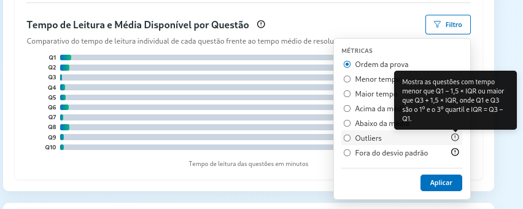 | 3 | <!--{{frequência/impacto/persistência}}-->Acontece toda vez que o usuário acessa a tooltip em busca de informação; O usuário pode entender errado as informações, impactando em suas decisões sobre as métricas | Tornar os textos das tooltips mais claros e simples |
| V04 | H8 | F03.e1 | No campo para colocar a duração da prova é possivel colocar um valor maior que o limite | 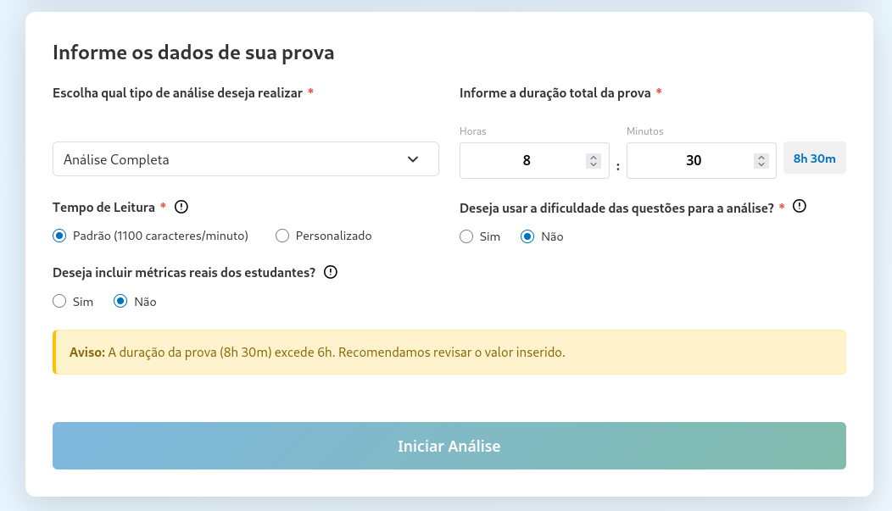 | 1 | Acontece toda vez que o usuário coloca um valor acima do permitido pelo sistema; Apenas faz o usuário perder um tempo com a possibilidade de colocar um tempo maior que o permitido | Tornar impossivel colocar um valor maior que 6h |

**Qualidade do relato:** o problema deve ser observável e localizado. Evite “interface confusa” sem dizer **o que**, **onde**, **quando** e **para quem**.

### 6. Boas práticas — heurísticas não violadas (atividade didática)

| Heurística sem violação | Exemplo no sistema | Evidência | Por que atende |
|---|---|---|---|
| H1 | Erro de arquivo no formato errado no upload |  | Se um arquivo que não esta no formato correto for colocado no sistema ele avisa sobre o erro  |
| H3 | Ao dar upload em uma prova e o sistema não detectar nenhuma questão, o sistema mostra uma caixa de erro e um botão de tentar novamente para o sistema tentar dnv detectar quetões, como tambem, na mesma cena é possivel tirar o envio para trocar o arquivo que sera avaliado | 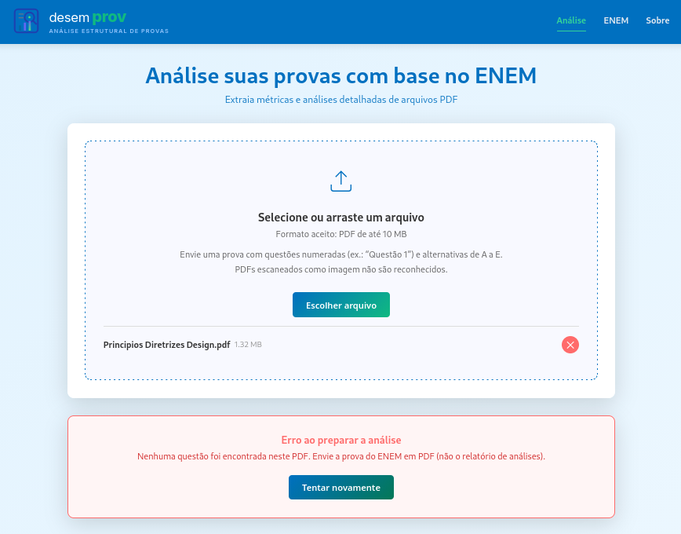 | Ele atende pois ao dar um erro o sistema da alternativas para restaurar o sistema para o estado anterior, como tambem ao fazer a analise existe um botão para voltar para a página de upload |
| H4 | Os erros do sistema | , 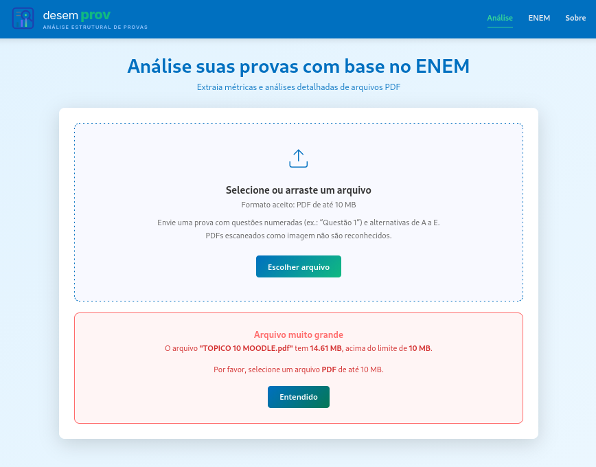 | Pois todos os erros tem botões com a mesma linguagem quando a ideia para consertar o  erro é a mesma |
| H5 | Nossa tela de input | 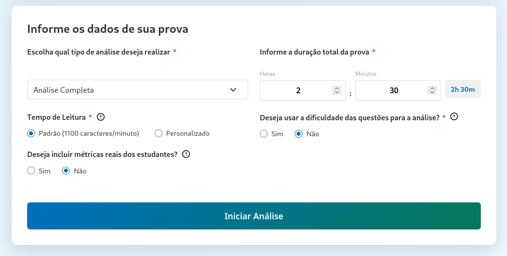 | Os botões e campos preenchiveis são bem visiveis e explicativos, e quando não é, há uma explicação em i informativos |
| H6 | A possibilidade de ou digitar ou usar setas nos campos numericos dos inputs |  | Pois tras mais flexibilidade no uso do sistema, dando varias maneiras de fazer uma mesma ação |
| H7 | Nos inputs, apenas perguntamos oque é realmente necessario |  | Pois tudo é necessario e nada é excessivo |
| H9 | Nossa tela de erro de formato no upload |  | Pois nela temos a possibilidade de voltar para o fluxo normal apertando o botão |
| H10 | Nosso i de informação no tempo de leitura | 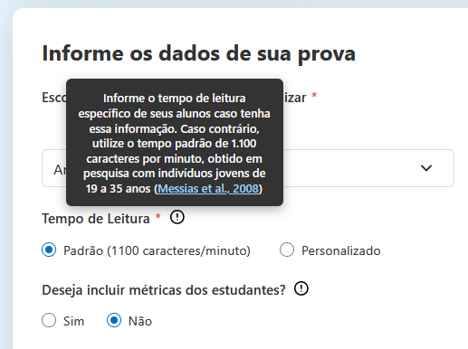 | Pois documenta de forma clara e informativa pra que serve e porque usamos essa métrica padrão |

## Avaliador A03 — Nuno Martins Guilhermino da Silva

### 4. Matriz de cobertura das 10 heurísticas

| Heurística | Telas/fluxos examinados | Houve violação? | IDs dos achados | Exemplo de boa prática se não violada |
|---|---|---|---|---|
| H1 | f03, f03_1, f03_2, f03_3, f03_4, f03e1, f01,f02,f02e1,f02e2,f02e3,f03e4, f04, f04_1, f04_2, f04_3, f04_4, f04e1, f04e2 | não | | O feedback rápido dado ao usuário caso ele faça upload de um arquivo inválido para análise. |
| H2 |  f03, f03_1, f03_2, f03_3, f03_4, f03e1, f01,f02,f02e1,f02e2,f02e3,f03e4, f04, f04_1, f04_2, f04_3, f04_4, f04e1, f04e2  | sim | F04_3 |  |
| H3 |f03, f03_1, f03_2, f03_3, f03_4, f03e1, f01,f02,f02e1,f02e2,f02e3,f03e4, f04, f04_1, f04_2, f04_3, f04_4, f04e1, f04e2  | não |  | Durante o upload de um arquivo, caso ele seja inválido, o usuário pode remover o arquivo mandado da área de upload e fazer o reupload com outro arquivo |
| H4 |f03, f03_1, f03_2, f03_3, f03_4, f03e1, f01,f02,f02e1,f02e2,f02e3,f03e4, f04, f04_1, f04_2, f04_3, f04_4, f04e1, f04e2  | não |  | Os termos de tópicos que são analisados são usados da mesma forma e com mesmo significado consistentemente pela aplicação completa.|
| H5 |f03, f03_1, f03_2, f03_3, f03_4, f03e1, f01,f02,f02e1,f02e2,f02e3,f03e4, f04, f04_1, f04_2, f04_3, f04_4, f04e1, f04e2  | não |  | Instruções para ações que requerem participação do usuário são disponibilizadas ou em instruções default, ou através de tooltips no caso da inserção de dados da prova |
| H6 |f03, f03_1, f03_2, f03_3, f03_4, f03e1, f01,f02,f02e1,f02e2,f02e3,f03e4, f04, f04_1, f04_2, f04_3, f04_4, f04e1, f04e2  | não |  | Na seção de inserção de dados, são dados informações opcionais que o usuário pode inserir caso queira uma análise mais completa.|
| H7 |f03, f03_1, f03_2, f03_3, f03_4, f03e1, f01,f02,f02e1,f02e2,f02e3,f03e4, f04, f04_1, f04_2, f04_3, f04_4, f04e1, f04e2  | não |  | A seção de gráficos contém apenas os resultados das análises, legendas e breves explicações para contextualização de cálculos. |
| H8 |f03, f03_1, f03_2, f03_3, f03_4, f03e1, f01,f02,f02e1,f02e2,f02e3,f03e4, f04, f04_1, f04_2, f04_3, f04_4, f04e1, f04e2  | sim | F02_E1,F02_E3, F03_E1 |  |
| H9 |f03, f03_1, f03_2, f03_3, f03_4, f03e1, f01,f02,f02e1,f02e2,f02e3,f03e4, f04, f04_1, f04_2, f04_3, f04_4, f04e1, f04e2  | não |  | Durante o upload do arquivo, o usuário é notificado do exato erro que aconteceu, seja falta de questões encontradas ou arquivo inválido. |
| H10 |f03, f03_1, f03_2, f03_3, f03_4, f03e1, f01,f02,f02e1,f02e2,f02e3,f03e4, f04, f04_1, f04_2, f04_3, f04_4, f04e1, f04e2 | não |  | São fornecidas informações e instruções de uso e explicações de resultados através de trechos de texto, legendas e tooltips presentes por volta da aplicação |

### 5. Declaração de violações

| ID | Heurística | Tela/estado | Problema observado | Evidência | Severidade | Justificativa da severidade | Recomendação |
|---|---|---|---|---|---:|---|---|
| V01 | H2 | F04_3 | Quando se olha o tooltip do filtro, é usada uma sigla não esclarecida anteriormente ao usuário, podendo alienar pessoas com menos experiência | 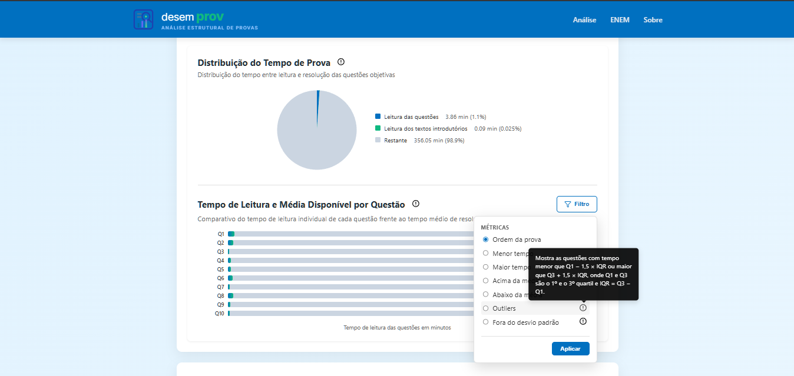 | 3 | O impacto desta violação é de um preocupação maior, já que, não conseguindo compreender tudo que está sendo mostrado a ele, pode ser comprometida a sua interpretação dos resultados apresentados | Definir siglas usadas antes do uso em fórmulas|
| V01 | H8 | F03_1 | Quando vai além do limite de horas, ele mostra uma mensagem de erro para o usuário por ter ultrapassado o limite. | 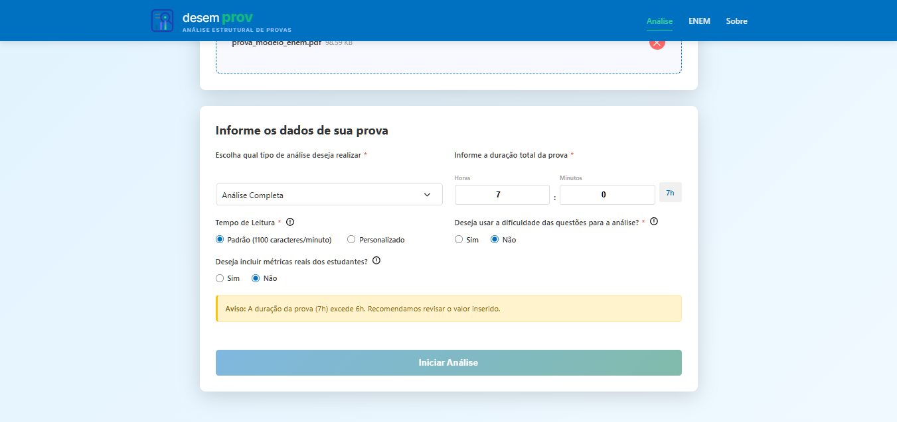 | 1 | Tem baixo impacto por ainda impedir o usuário de progredir para a próxima etapa. | Impedir o usuário de fazer um input acima de 6 horas.|

**Qualidade do relato:** o problema deve ser observável e localizado. Evite “interface confusa” sem dizer **o que**, **onde**, **quando** e **para quem**.

### 6. Boas práticas — heurísticas não violadas (atividade didática)

| Heurística sem violação | Exemplo no sistema | Evidência | Por que atende |
|---|---|---|---|
| H1 | F2E1 | 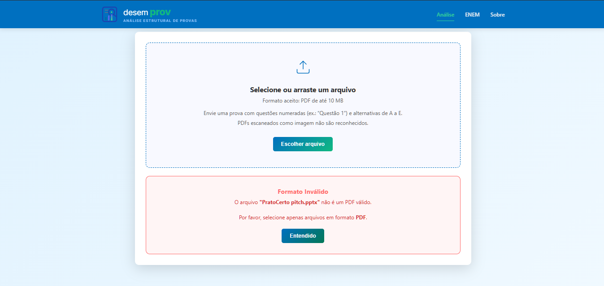  | O feedback aparece de forma rápida e com instruções claras para o usuário. |
| H3 | F02E2 | 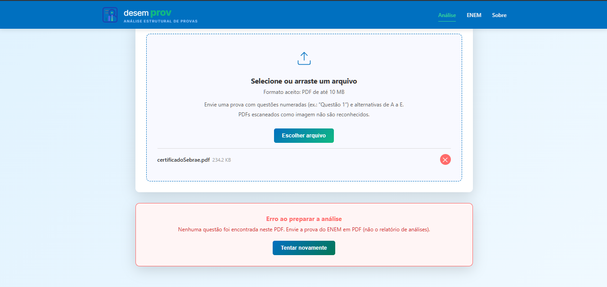  | O feedback aparece com a opção de tentar novamente, podendo retirar o usuário de estado de erro|
| H4 | F04 | 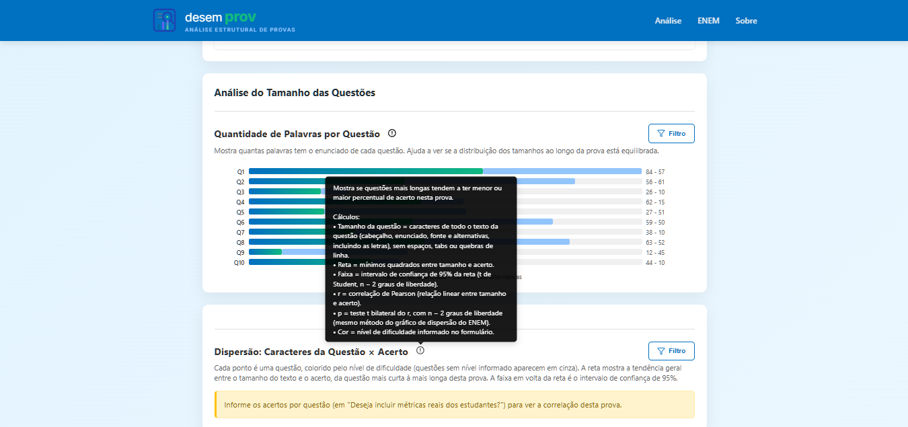  | Tem explicações e esclarecimentos do significado de termos e ações, além de consistentemente utilizar o mesmo termo em múltiplas telas|
| H5 | F01 | 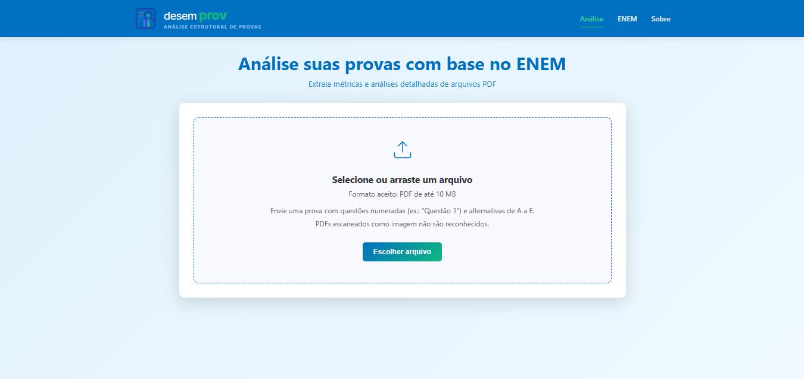  | São mostradas instruções das ações que o usuário deve fazer.|
| H6 | F03 | 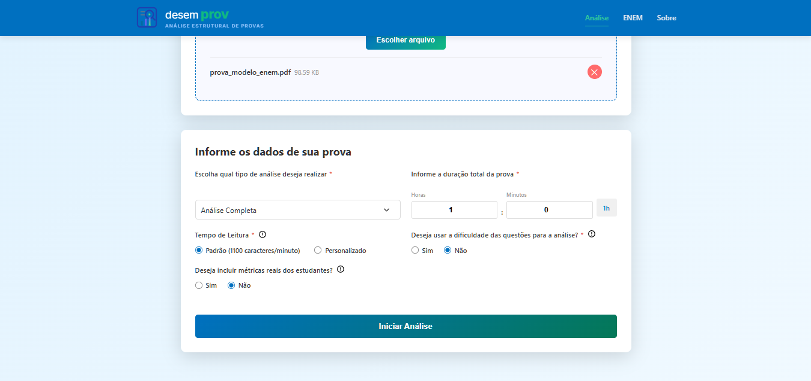  | São dadas opções ao usuário que facilitam o seu uso da aplicação, dependendo do nível das informações que ele deseja colocar no sistema.|
| H7 | F04 | 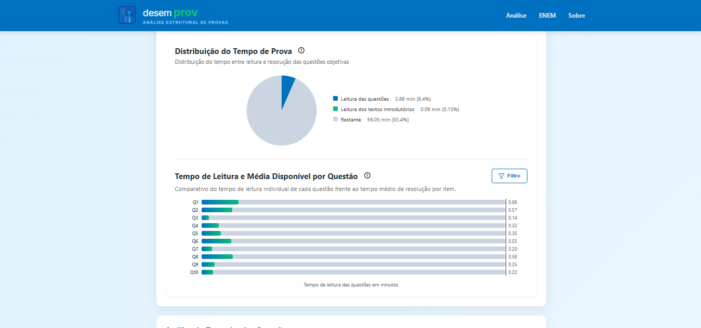  | São apresentadas ao usuário apenas informações que são relevantes ao objetivo do usuário, mostrando apenas instruções e contextualização onde necessário.|
| H9 | F02_E3 | 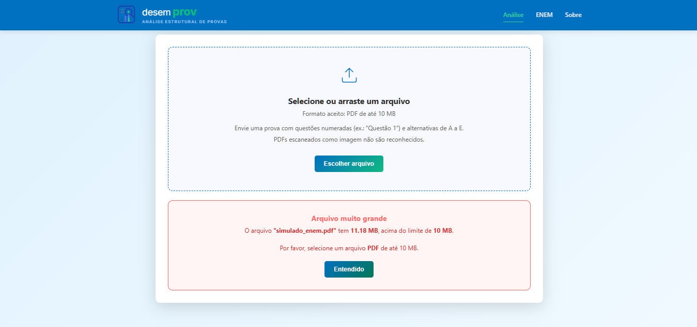  | Na ocorrência de um erro, é sempre mostrado ao usuário o erro exato e como mitigar.|
| H10 | F03_1 | 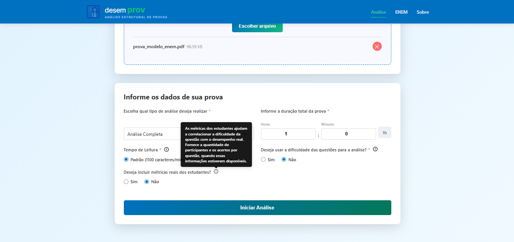  | Através dos tooltips, são mostradas informações como passos, objetivos, restrições e cálculos utilizados.|

> Repita a seção para A02, A03... um avaliador por integrante.

## 7. Consolidação da equipe <!-- FAZER -->

Problemas iguais ou muito semelhantes encontrados por avaliadores diferentes devem ser consolidados, preservando quem os encontrou.

| ID consolidado | Achados individuais | Heurística | Problema | Severidade final | Prioridade | Responsável pela correção |
|---|---|---|---|---:|---|---|
| HC01 | V01(A01), V04(A02) | H1 | {{...}} | {{...}} | alta | {{...}} |

## 8. Síntese e plano de melhoria <!-- FAZER -->

- Quantidade de problemas por heurística e severidade.
- Problemas críticos/graves que bloqueiam teste ou release.
- Padrões recorrentes entre telas.
- Correções que serão feitas antes/para a avaliação com usuários.

## Checklist <!-- FAZER -->

- [ ] Cada integrante fez uma inspeção completa e identificada.
- [ ] Todas as telas/estados relevantes foram examinados.
- [ ] Estados administrativos, filtros, relatórios, históricos, processamento e erros foram incluídos quando existentes.
- [ ] A inspeção avaliou a interface/protótipo, não o mérito técnico do algoritmo/modelo.
- [ ] H1–H10 aparecem na matriz de cobertura de cada avaliador.
- [ ] Parte de violações contém apenas violações, sem “forçar” exemplos.
- [ ] Todo problema tem print/localização e contexto.
- [ ] Severidade possui justificativa, não apenas número.
- [ ] Recomendação resolve a causa ou reduz o impacto.
- [ ] Achados duplicados foram consolidados ao final.
