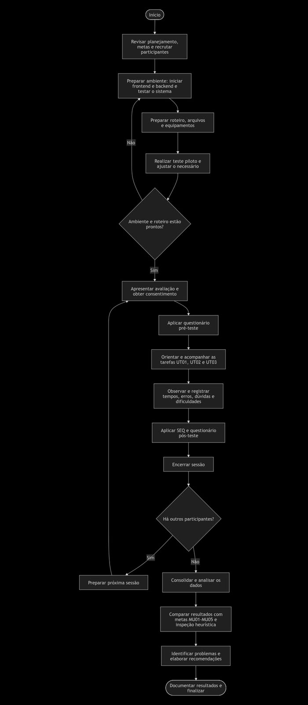

# Entrega 14 — Avaliação de usabilidade por observação de usuários

**Data:** 08/11/2026 
**Status:**  🟩 concluido 
**Responsabilidade:** solução consolidada por equipe. O número de participantes finais observados deve ser igual ao número de integrantes, conforme o modelo da disciplina; recomenda-se que cada integrante seja responsável por conduzir/analisar ao menos um participante.
<!--
anotacao topico 12 e 14....
todo metodo de avalaicao é baseado em 
-prearacao
-coleta de dados
-interpretacao
-consolidacao
-relato dos resultados

PREPARACAO PARA AVALIACAO: tem q ter perfies e numero de pariticpantes (10 usuarios eh produtivo p avalaicao p evitar falhas, n precisa passar de 10 pq ai tem recorrencia dos erros, tem so dado de peso dos erros p ve rmaior impacto..)

 Prototipo uso p avaliacao herusitica e teste de obs de usuario 

Faremos colocando pessoas de fora da equipe, colegas da turma, professores(preferencialmente), orientadors, familiares....  
 -->
## Objetivo da atividade

Observar usuários representativos realizando tarefas reais ou realisticamente simuladas para identificar problemas de eficácia, eficiência, compreensão e satisfação que não podem ser inferidos apenas por inspeção.

> **Participantes finais não devem ser membros da equipe.** Um integrante pode participar do teste piloto apenas para validar roteiro/equipamentos, sem contar na amostra final.

### Quando o usuário é um perfil profissional especializado

Em TCCs técnicos, o público pode ser DBA, analista, pesquisador, administrador, técnico ou outro especialista. Priorize participantes que possuam relação real com as tarefas. Se não for possível recrutar o perfil ideal, qualquer participante aproximado/proxy deve ser **justificado previamente e tratado como limitação**; não apresente o resultado como equivalente ao de especialistas reais.

O teste avalia a **interação com o protótipo**. Não é necessário que o participante valide o desempenho científico do algoritmo. Resultados simulados podem ser usados quando declarados e coerentes com a tarefa.

Tarefas podem envolver, por exemplo, interpretar um dashboard, configurar uma análise, encontrar uma execução no histórico usando filtros, comparar resultados, gerar relatório, revisar alerta ou administrar permissões.

## A. Fluxograma do processo — equipe 

<!--O fluxograma deve representar, no mínimo: planejamento → recrutamento → consentimento → preparação → execução das tarefas/observação → pós-teste → consolidação/análise → recomendações.-->

## B. Procedimento de preparação e execução — equipe

### Passo 1 — Objetivos e versão avaliada 

**Versão/commit/Figma:** verão atual do código disponível em: [Repositório TCC](https://github.com/beatrizmanaia26/TCC-DesempenhoEnem) 
**Metas de usabilidade relacionadas:** MU01 (facilidade de aprendizado), MU02 (facilidade de memorização), MU03 (eficiência), MU04 (taxa e gravidade de erros) e MU05 (satisfação).

### Passo 2 — Participantes 

| ID | Perfil | Critérios que justificam participação | Integrante responsável |
|---|---|---|---|
| U01 | P01 | Professor que atua na docência, representa o público-alvo do sistema, por possuir familiaridade com o contexto educacional. | Luana |
| U02 | P02 | Colega de turma que já cursou a disciplina de IHC, mas não participou do desenvolvimento do projeto. Possui conhecimentos básicos sobre usabilidade, permitindo avaliar a interface sem influência das decisões tomadas pela equipe durante o desenvolvimento. | Beatriz |
| U03 | P03 | Professor que atua na docência, representa o público-alvo do sistema, por possuir familiaridade com o contexto educacional. | Nuno |

### Passo 3 — Consentimento e privacidade 

- Termo/registro de consentimento: [Modelo de termo de consentimento](../instrumentos/termo_consentimento_modelo.md)  
- Gravação de tela/áudio/vídeo: Sim, mediante autorização do participante. A gravação de tela será utilizada para analisar a navegação, identificar dificuldades e verificar as ações realizadas durante as tarefas. A gravação de áudio poderá ser utilizada para registrar comentários e dúvidas verbalizadas durante a avaliação. 
- Forma de anonimização:  Os participantes serão identificados exclusivamente por códigos, como ⁠ U01 ⁠, ⁠ U02 ⁠ e ⁠ U03 ⁠, sem utilização de nomes ou outras informações pessoais nos registros e na apresentação dos resultados. 
- Local e período de armazenamento: Os registros da avaliação serão armazenados em pasta digital de acesso restrito à equipe, durante o período de realização e análise da atividade. Após a consolidação dos resultados e a conclusão da avaliação, os arquivos contendo gravações serão excluídos.  

### Passo 4 — Teste piloto

**Data:** 11/11
**O que foi validado:** roteiro da apresentação, duração, entendimento das instruções, protótipo, gravação.
**Mudanças após piloto:** Nada

### Passo 5 — Tarefas 

| ID | Cenário/instrução apresentada | Critério de sucesso | Métricas | Ligação com modelo |
|---|---|---|---|---|
| UT01 | Você é um professor e precisa analisar uma prova para compreender características de sua estrutura e identificar aspectos que possam influenciar o desempenho dos alunos. Utilize o sistema para enviar o arquivo da prova, preencher os parâmetros solicitados e realizar a análise. Ao final, explore os resultados apresentados e explique o que conseguiu compreender a partir das métricas disponíveis. | O participante consegue enviar o PDF aceito, preencher os parametros necessários, iniciar a análise e acessar os resultados. Além disso, consegue identificar e explicar o significado das principais métricas apresentadas, sem auxilio do moderador | taxa de sucesso, tempo de execução, quantidade de erros, taxa de recuperação, pedidos de ajudas, satisfação  pós tarefa| T01/M01/M02/M03/f01,f02,f02e1,f02e2,f02e3,f02e4,f03,f03_1,f03_2,f03_3, f03_4,f03e1, f04,f04_1,f04_2,f04_3,F04_4,F04e1,f04e2 |
| UT02 | Você é um professor e já aplicou uma prova, mas percebeu que o desempenho dos alunos ficou diferente do esperado. Você deseja investigar se características relacionadas ao formato da avaliação podem ajudar a compreender esse resultado. Utilize o sistema para enviar a prova já aplicada, preencher as informações solicitadas e gerar a análise. | O participante consegue enviar o PDF, preencher as informações necessárias e gerar a análise da prova sem auxílio do moderador. | Taxa de sucesso, tempo de execução, quantidade de erros, taxa de recuperação e pedidos de ajuda. | T01/M01/M02/M03/f01,f02,f02e1,f02e2,f02e3,f02e4,f03,f03_1,f03_2,f03_3, f03_4,f03e1, f04,f04_1,f04_2,f04_3,F04_4,F04e1,f04e2 |

### Passo 6 — Protocolo do moderador <!--fazer -->

1. Receber participante e explicar que **o produto está sendo avaliado, não a pessoa**.
2. Obter consentimento.
3. Aplicar perfil pré-teste mínimo necessário.
4. Ler instruções padronizadas.
5. Observar sem ensinar o caminho; registrar pedidos de ajuda separadamente.
6. Se usar *think aloud*, explicar e aplicar de forma consistente.
7. Após cada tarefa, registrar satisfação/SEQ ou escala definida.
8. Fazer pós-teste/entrevista breve.
9. Encerrar e explicar uso dos dados.

## C. Resultados — por participante

### U01 — P01

| Tarefa | Grau de sucesso | Erros | Tipos de erro/dificuldade | Ajudas | Tempo | Satisfação | Evidência/observação |
|---|---|---:|---|---:|---|---|---|
| UT01 | parcial | 2 | 1. No grafico de tempo de leitura e média disponivel por questão não ficou explicito oque eram os numeros na direita; 2. No grafico da correlação entre tamanho da questao e percentual de acertos por dificuldade faltou o aviso que não tem esse grafico pela falta do input | 3 (1. Precisamos ajuda-lo a escolher o arquivo da prova; 2. Tivemos que explicar a falta do grafico de correlação tamanho e percentual de acertos, por causa da falta do aviso; 3. Tivemos que avisar quando parar pois o sistema que foi utilizado não estava finalizado e tinha muitas coisas descartaveis no final da pagina) | 6:58 (apenas teste da aplicação) 17:38 (completo) | 80% | O participante sugeriu melhorar a nomenclatura, pois a expressão "Mediana da caracteres" não faz sentido, sendo mais adequado utilizar "Mediana da quantidade de caracteres". Também não demonstrou preferência pela navegação por rolagem da página, sugerindo que cada análise fosse apresentada em uma página separada. Em relação aos gráficos, recomendou alterar as cores para dar maior destaque a informações importantes, como a categoria "Restante" no gráfico de distribuição do tempo de prova, além de substituir essa legenda por uma descrição mais explícita. Também sugeriu dar maior destaque às legendas, cujas cores considerou muito apagadas. Além disso, considerou os degradês utilizados nos gráficos desnecessários e prejudiciais à visualização. Por fim, recomendou apresentar as informações de maneira mais explícita, apontando que, no gráfico "Tempo de leitura e média", os dados complementares aparecem apenas ao passar o mouse sobre o gráfico, funcionalidade que não percebeu durante a avaliação. |
| UT02 | total | 0 | -- | 0 | 8:24 (apenas teste da aplicação) 17:52 (completo) | 90% | O participante não considerou interessante a apresentação de todos os campos de entrada (inputs) em uma única página. Em relação às análises, gostou do gráfico de acertos por quantidade, destacando que as informações estavam bem explicadas. Entretanto, reforçou a necessidade de tornar os textos mais explícitos, como substituir "caracteres" por "número de caracteres". Também considerou interessante a proposta do projeto, principalmente durante essa tarefa, por apresentar uma maior variedade de análises. Sugeriu ainda tornar as representações mais claras, explicitando, por exemplo, que Q1 se refere à primeira questão. Quanto à visualização da correlação, não gostou da forma como foi apresentada no mapa de calor vertical, sugerindo que sua orientação fosse alterada para horizontal ou que essa representação fosse substituída por outra forma de visualização. Além disso, recomendou melhorar as cores dos gráficos e tornar mais evidente quando o PDF está sendo analisado pelo sistema. Por fim, sugeriu a inclusão de mais análises, considerando que, no momento da avaliação, nem todas as funcionalidades previstas estavam disponíveis no sistema. |

<!-- 
| UT02 | parcial | {{n}} | {{...}} | {{n}} | inicio: fim: (apenas teste da aplicação) | {{escala}} | {{fala/comportamento}} |
-->

**Resposta pré-teste:** [pré-teste respondido](../instrumentos/questionario_preU01.md) 
**Link da gravação (se autorizado):** [vídeo não listado youtube U01 ](https://youtu.be/o_e_1TrHtNs) 
**Resposta pós-teste:** [pós-teste respondido](../instrumentos/questionario_posU01.md)

### U02 — P02

| Tarefa | Grau de sucesso | Erros | Tipos de erro/dificuldade | Ajudas | Tempo | Satisfação | Evidência/observação |
|---|---|---:|---|---:|---|---|---|
| UT01 | total | 1 |  Apenas a compreensão errado do cenário, que logo foi corrigida pela desenvolvedora para não compometer o fluxo desejado de teste. Buscar informação da difucldade das questões, foi o ponto em que a usuária mais demonstrou lentidão | relembramos o fluxo/tarefa inicial para que fossem preenchidos os dados corretamente | 08:21 (completo), 05:36 (apenas teste da aplicação) | 100% | comportamentos e falas muito positivos que demonstram compreensão plena das atividades a serem realizadas, dos gráficos e do objetivo da aplicação "ficou bem legal os botões de seleção do tipo de análise", "iterativa a mudança de página","ficou claro de analisar o dado de tempo de leitura e média disponível por questão"|
| UT02 | parcial | 2 | Não conseguiu interpretar claramente um dos gráficos (correlação) e ao seguir a primeira tarefa entendeu errado. Análise de um dos gráficos foi realizada levando em consideração apenas um dos 3 fatores, precisamos deixar mais claro no texto para que esse erro não ocorra de novo | Após informar as tarefas/situações para os testes, a primeira tarefa não foi compreendida plenamente, o que quase gerou o primeiro treste falho (a usuária quase informou dados a mais), foi necessário intervir para relembrar a tarefa específica e garantir o fluxo correto de uso. Além disso, percebi que a compreensão do gráfico de correlação foi parcialmente prejudicada, provavelmente devido a nao leitura completa a descrição ou da má escolha, por parte dos devs, em posicionar as informações descritivas | 8:92 (completo), 08:87 (apenas teste da aplicação) | 90% | A usuária acredita que os textos descritivos poderiam ser resumidos, quase nunca utilizou os tooltips de informação (apenas para entender o que seriam textos introdutórios, utilizando o ícone ao lado da frase "textos introdutórios" o que fez com que nós devs ajustassemos o código para manter essa informação apenas nessa tooltip, além disso teve a dificuldade em analisar o gráfico de correlação ("não sei se entendi o gráfico de correlação"), porém após ler a descrição compreendeu melhor, estamos trabalhando no ajuste para o erro nao ocorrer novamente, as falas foram em suma muito positivas como, "achei bem iterativo e bem legal o gráfico de dispersão e sua visualização", "gráficos bem visíveis", mostrando bastante compreensão da plataforma, de seus fluxos e objetivos, conseguiu utilizá-la bem seguindo o propósito)|

**Resposta pré-teste:** [pré-teste respondido](../instrumentos/questionario_preU02.md) 
**Link da gravação (se autorizado):** [vídeo não listado youtube U02 ](https://youtu.be/KgpqN43J2uQ) 
**Resposta pós-teste:** [pós-teste respondido](../instrumentos/questionario_posU02.md)

### U03 — P03

| Tarefa | Grau de sucesso | Erros | Tipos de erro/dificuldade | Ajudas | Tempo | Satisfação | Evidência/observação |
|---|---|---:|---|---:|---|---|---|
| UT01 | total | 4 | Não tinha compreendido completamente a seção de preenchimento de dados da prova, teve que ser auxiliado pela equipe. Ter um maior destaque do que tem que ter inputs do usuário. Teve também uma confusão com a seção de resultados quando o usuário não preencheu o número de acertos de cada questão, achando que o aviso mostrado ao usuário era na verdade um prompt para o usuário responder. O participante também inicialmente não reconheceu que ele estava na tela de resultados. O partipante tentou iniciar a análise sem ter preenchido o campo obrigatório de tempo de duração da avaliação. | 1 - Foi auxiliado o usuário a compreender que primeiramente tinha que ser preenchidas as informações da prova antes de pressionar o botão de iniciar análise. 2 - Foi auxiliado a digitar o tempo de duração da prova, já que não tinha entendido que era possível digitar. 3 - Foi informado que o aviso sobre o número de acertos não preenchidos era uma respostas ao invés de uma pergunta para ser respondida pelo usuário | 13:00(completo), 11:15(Apenas uso da aplicação)  | 90% | Teve dificuldades em entender parcialmente como utilizar o sistema, tendo algumas dúvidas durante o preenchimento de dados, qual era a seção de resultados do sistema, além de certa confusão na identificação do que precisava ser respondido pelo usuário. Além disso, recomendou mudar o esquema de cores do botão de voltar na página de resultados, ter um rolador mais visível na aplicação   |
| UT02 | total | 1 | Não compreendeu inicialmente que a seção de métricas reais exigia o preenchimento manual do número de acertos por questão, acreditando que os resultados seriam carregados automaticamente pelo sistema. | 1 - Ajuda para explicar o significado da seção de registrar número de acertos. | 14:20(completo), 6:05(Apenas uso da aplicação) | 100% | O participante apresentou maior facilidade na navegação em comparação à UT01, demonstrando melhor compreensão do funcionamento da aplicação. Conseguiu interpretar os gráficos e identificar divergências entre a dificuldade atribuída às questões e os resultados dos alunos. Sugeriu melhorias na diferenciação visual de resultados positivos e negativos, na legibilidade dos gráficos, na disponibilização de explicações adicionais e na navegação por páginas, considerando professores com menor familiaridade tecnológica. |

**Resposta pré-teste:** [pré-teste respondido](../instrumentos/questionario_preU03.md) 
**Link da gravação (se autorizado):** [vídeo não listado youtube U03 ](https://youtu.be/0Oeqd5tKSfU) 
**Resposta pós-teste:** [pos-teste respondido](../instrumentos/questionario_posU03.md)

> Repita para U02, U03...

## D. Consolidação por tarefa 
| Tarefa | Taxa de sucesso | Tempo típico | Erros recorrentes | Satisfação | Meta atendida? | Problemas prioritários |
|---|---:|---|---|---|---|---|
| UT01 | 67% (2 totais e um parcial) | 12:26 (tempo completo) | Dificuldades no preenchimento dos parâmetros da prova, compreensão das informações apresentadas nos gráficos e identificação de funcionalidades. | 90% | parcialmente | Melhorar a orientação durante o preenchimento dos dados e tornar mais explícitas as informações e legendas dos gráficos. |
| UT02 | 67% (2 totais e um parcial) | 13:52 (tempo completo) | Compreensão um pouco equivocada do gráfico de dispersão | 93,3% | parcialmente | Revisar a descrição e a representação do gráfico de correlação, esclarecer os dados que precisam ser preenchidos manualmente e melhorar a organização das informações apresentadas. |

## E. Achados e recomendações 
| ID | Achado | Evidência (quant. + qual.) | Impacto | Recomendação | Artefatos a revisar |
|---|---|---|---|---|---|
| AU01 | Dificuldade na interpretação do gráfico de correlação. | U01 precisou de ajuda para compreender a ausência do gráfico devido à falta de um parâmetro. U02 apresentou dificuldade para interpretar o gráfico e compreender quais fatores deveriam ser considerados na análise. | Alto | Reformular os textos explicativos, deixar mais evidente quais fatores devem ser considerados e informar claramente quando um gráfico não puder ser gerado. Avaliar também melhorias na representação visual. | Graficos, F04 e F04.2 |
| AU02 | Informações e nomenclaturas pouco explícitas. | U01 apontou problemas em expressões como "Mediana da caracteres" e não percebeu informações disponíveis apenas em tooltips. U02 também sugeriu tornar os textos mais explícitos. U03 apresentou dúvidas sobre o significado de informações e avisos. | Alto | Revisar nomenclaturas, legendas e descrições, utilizando termos mais claros e explicando abreviações e informações técnicas. Priorizar informações essenciais visíveis sem depender exclusivamente de tooltips. | Textos de titulos e legendas, F04 e F04.2 |
| AU03 | Dificuldades na identificação e no preenchimento dos campos de entrada. | U03 apresentou dificuldades para identificar os campos que deveriam ser preenchidos, compreender quais eram obrigatórios e registrar o número de acertos manualmente. | Médio | explicar quais informações devem ser fornecidas pelo usuário e apresentar orientações mais claras durante o preenchimento. | F03, F03.4, Texto de explicação do upload |
| AU04 | Organização e navegação das páginas. | U01 e U03 sugeriram melhorias na navegação por rolagem e na organização das análises. U01 sugeriu separar cada análise em uma página, enquanto U03 recomendou um rolador mais visível. | Médio | Avaliar a organização das análises em páginas ou seções mais bem delimitadas. | Estruturação das paginas e navegação |
| AU05 | Problemas de destaque visual e diferenciação das informações. | U01 recomendou melhorar as cores dos gráficos e das legendas, além de remover degradês. U03 também sugeriu melhorias nas cores e na diferenciação visual dos resultados positivos e negativos. | Médio | Revisar a paleta de cores, melhorar o contraste das legendas e utilizar diferenciação visual mais clara para os resultados. | Graficos, legendas, F01 |
| AU06 | Necessidade de maior clareza no estado de processamento e na disponibilidade das análises. | U01 e U03 apresentaram dúvidas durante o fluxo de utilização e sobre informações exibidas pelo sistema. U01 também não percebeu a ausência de um gráfico devido à falta de um aviso. Além disso, U01 sugeriu tornar mais evidente quando o PDF está sendo analisado. | Médio | Adicionar indicadores visuais de processamento, mensagens de estado e avisos explícitos sobre análises indisponíveis ou informações pendentes. | Mensagens de erro, fluxo de processamento |

## F. Comparação com a avaliação heurística 
| Problema | Detectado na heurística? | Detectado por usuários? | O que aprendemos |
|---|---|---|---|
| Nomenclaturas e informações pouco explícitas. | sim | sim | A utilização de siglas e termos pouco explicativos pode dificultar a compreensão das análises. É importante utilizar nomenclaturas mais claras e fornecer explicações explícitas, sem depender exclusivamente de tooltips. |
| Inconsistência nas mensagens de erro. | sim | não | Mesmo que os participantes não tenham percebido o problema durante as tarefas, manter padrões consistentes nas mensagens e nos botões de recuperação contribui para uma experiência mais previsível. |
| Possibilidade de inserir uma duração de prova superior ao limite permitido. | sim | não | A inspeção heurística permite identificar problemas de prevenção de erros que podem não aparecer durante os testes com usuários, reforçando a importância de combinar os métodos de avaliação. |
| Dificuldades na interpretação dos gráficos e das correlações. | sim | sim | Além de explicar adequadamente os termos utilizados, é necessário garantir que as próprias representações gráficas sejam compreensíveis. A disposição e o formato dos gráficos também influenciam sua interpretação. |
| Organização e navegação das análises e dos campos de entrada. | não | sim | As preferências de navegação podem variar entre usuários. É importante avaliar a organização das informações. |
| Destaque visual e legibilidade dos gráficos. | não | sim | A escolha de cores, o contraste das legendas e a diferenciação visual das informações influenciam a facilidade de leitura e interpretação dos gráficos. |
| Clareza dos estados de processamento e das informações disponíveis. | não | sim | É importante comunicar de maneira explícita quando o PDF está sendo analisado e quando determinadas análises não estão disponíveis, evitando que o usuário precise descobrir essas informações por conta própria. |

## G. Conclusão 
<!--
A conclusão deve responder:

1. Quais metas de usabilidade foram atingidas?
2. Quais problemas foram recorrentes e com quais perfis/tarefas?
3. O que surpreendeu a equipe?
4. Quais mudanças são prioritárias?
5. Que limitações do teste impedem generalizações amplas?
-->

A avaliação permitiu identificar aspectos positivos e oportunidades de melhoria no sistema, considerando a realização de duas tarefas por três participantes. Quantitativamente, ambas as tarefas apresentaram taxa de sucesso de 67%, considerando conclusões totais e parciais. Os tempos registrados foram de 12 minutos e 26 segundos para UT01 e 13 minutos e 52 segundos para UT02, permanecendo abaixo dos 15 minutos planejados para cada tarefa. Além disso, os níveis de satisfação foram de 90% e 93,3%, respectivamente. Esses resultados indicam uma boa aceitação do sistema e o cumprimento da meta de tempo estabelecida, embora as metas gerais de usabilidade tenham sido parcialmente atendidas nas duas tarefas.

Do ponto de vista qualitativo, os participantes demonstraram interesse na proposta e avaliaram positivamente a variedade e a utilidade das análises apresentadas. Entretanto, foram identificadas dificuldades recorrentes relacionadas à compreensão das nomenclaturas e dos gráficos, ao preenchimento dos parâmetros da prova e à organização das informações. Também foram sugeridas melhorias na apresentação visual dos gráficos, principalmente em relação às cores, ao contraste das legendas e à disposição dos elementos. Na UT02, destacou-se ainda a dificuldade de interpretação do gráfico de dispersão, indicando a necessidade de revisar sua representação e descrição.

A comparação com a avaliação heurística evidenciou a complementaridade dos métodos utilizados. Enquanto a inspeção heurística identificou problemas relacionados à consistência e à prevenção de erros, os testes com usuários permitiram observar dificuldades adicionais, especialmente na interpretação dos gráficos e na navegação pelo sistema. Por outro lado, alguns problemas identificados pelos avaliadores não foram percebidos durante as tarefas, reforçando a importância de combinar diferentes métodos de avaliação.

Como mudanças prioritárias, destacam-se a revisão das nomenclaturas e dos textos explicativos, a melhoria da representação dos gráficos de correlação, o aprimoramento da orientação durante o preenchimento dos campos de entrada e a reorganização das informações apresentadas. Também é importante melhorar as cores e legendas dos gráficos, tornar mais explícitos os estados de processamento do PDF e implementar as análises que ainda não estavam disponíveis na versão avaliada.

Por fim, a avaliação apresenta algumas limitações. O número reduzido de participantes não permite generalizar os resultados, além de apenas dois dos três participantes possuírem perfil diretamente relacionado ao público-alvo do sistema. Adicionalmente, a versão avaliada ainda não contemplava todas as análises previstas, limitando a avaliação de algumas funcionalidades. Dessa forma, os resultados devem ser considerados indicativos de problemas e oportunidades de melhoria, servindo como base para o aprimoramento da aplicação e para avaliações futuras com um número maior de professores.

## Checklist

- [x] Número de participantes finais atende ao enunciado.
- [x] Participantes são representativos do público e não são membros da equipe.
- [x] Se foram usados participantes proxy, a justificativa e a limitação estão explícitas.
- [x] O teste avalia a interação; não confunde usabilidade do protótipo com desempenho técnico do TCC.
- [x] Tarefas administrativas/analíticas usadas no teste são rastreáveis a objetivos e cenários.
- [x] Há consentimento e anonimização.
- [x] Foi realizado teste piloto.
- [x] Tarefas têm critérios de sucesso definidos antes do teste.
- [x] Moderadores não ensinaram o caminho durante a tarefa.
- [x] Resultados estão separados por usuário e por tarefa.
- [x] Foram registrados sucesso, erros, ajudas, tempo e satisfação quando aplicáveis.
- [x] Conclusão combina evidência quantitativa e qualitativa.
- [x] Achados geram recomendações e atualização da rastreabilidade.
