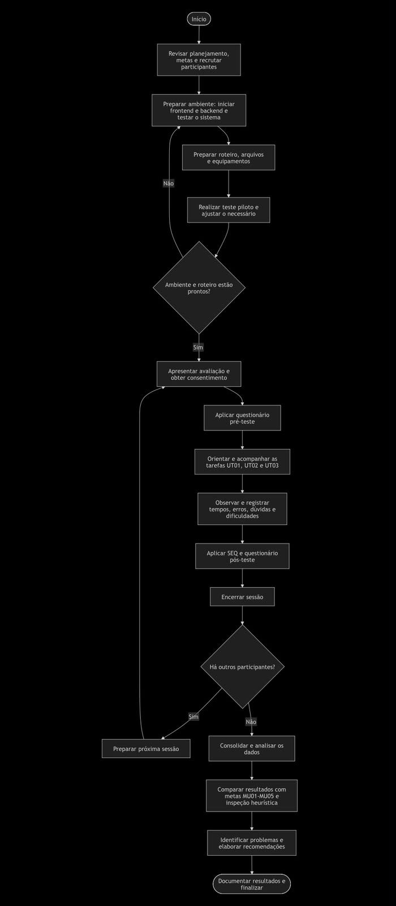

# Entrega 14 — Avaliação de usabilidade por observação de usuários

**Data:** 08/11/2026
**Status:**  🟨 Em andamento
**Responsabilidade:** solução consolidada por equipe. O número de participantes finais observados deve ser igual ao número de integrantes, conforme o modelo da disciplina; recomenda-se que cada integrante seja responsável por conduzir/analisar ao menos um participante.
<!--
anotacao topico 12 e 14....
todo metodo de avalaicao é baseado em 
-prearacao
-coleta de dados
-interpretacao
-consolidacao
-relato dos resultados

PREPARACAO PARA AVALIACAO: tem q ter perfies e numero de pariticpantes (10 usuarios eh produtivo p avalaicao p evitar falhas, n precisa passar de 10 pq ai tem recorrencia dos erros, tem so dado de peso dos erros p ve rmaior impacto..)

 Prototipo uso p avaliacao herusitica e teste de obs de usuario 

Faremos colocando pessoas de fora da equipe, colegas da turma, professores(preferencialmente), orientadors, familiares....  
 -->
## Objetivo da atividade

Observar usuários representativos realizando tarefas reais ou realisticamente simuladas para identificar problemas de eficácia, eficiência, compreensão e satisfação que não podem ser inferidos apenas por inspeção.

> **Participantes finais não devem ser membros da equipe.** Um integrante pode participar do teste piloto apenas para validar roteiro/equipamentos, sem contar na amostra final.

### Quando o usuário é um perfil profissional especializado

Em TCCs técnicos, o público pode ser DBA, analista, pesquisador, administrador, técnico ou outro especialista. Priorize participantes que possuam relação real com as tarefas. Se não for possível recrutar o perfil ideal, qualquer participante aproximado/proxy deve ser **justificado previamente e tratado como limitação**; não apresente o resultado como equivalente ao de especialistas reais.

O teste avalia a **interação com o protótipo**. Não é necessário que o participante valide o desempenho científico do algoritmo. Resultados simulados podem ser usados quando declarados e coerentes com a tarefa.

Tarefas podem envolver, por exemplo, interpretar um dashboard, configurar uma análise, encontrar uma execução no histórico usando filtros, comparar resultados, gerar relatório, revisar alerta ou administrar permissões.

## A. Fluxograma do processo — equipe 

<!--O fluxograma deve representar, no mínimo: planejamento → recrutamento → consentimento → preparação → execução das tarefas/observação → pós-teste → consolidação/análise → recomendações.-->

## B. Procedimento de preparação e execução — equipe

### Passo 1 — Objetivos e versão avaliada 

**Versão/commit/Figma:** verão atual do código disponível em: [Repositório TCC](https://github.com/beatrizmanaia26/TCC-DesempenhoEnem) 
**Metas de usabilidade relacionadas:** MU01 (facilidade de aprendizado), MU02 (facilidade de memorização), MU03 (eficiência), MU04 (taxa e gravidade de erros) e MU05 (satisfação).

### Passo 2 — Participantes <!--fazer -->

| ID | Perfil | Critérios que justificam participação | Integrante responsável |
|---|---|---|---|
| U01 | P01 | Professor que atua na docência, representa o público-alvo do sistema, por possuir familiaridade com o contexto educacional. | {{...}} |
| U02 | P02 | Colega de turma que já cursou a disciplina de IHC, mas não participou do desenvolvimento do projeto. Possui conhecimentos básicos sobre usabilidade, permitindo avaliar a interface sem influência das decisões tomadas pela equipe durante o desenvolvimento. | Beatriz |
| U03 | P03 | Amigo ou familiar que não conhece o projeto e não possui conhecimentos específicos de IHC. Representa um usuário sem familiaridade prévia com o sistema, permitindo observar dificuldades de compreensão, navegação e realização das tarefas. | {{...}} |

### Passo 3 — Consentimento e privacidade 

- Termo/registro de consentimento: [Modelo de termo de consentimento](../instrumentos/termo_consentimento_modelo.md)  
- Gravação de tela/áudio/vídeo: Sim, mediante autorização do participante. A gravação de tela será utilizada para analisar a navegação, identificar dificuldades e verificar as ações realizadas durante as tarefas. A gravação de áudio poderá ser utilizada para registrar comentários e dúvidas verbalizadas durante a avaliação. 
- Forma de anonimização:  Os participantes serão identificados exclusivamente por códigos, como ⁠ U01 ⁠, ⁠ U02 ⁠ e ⁠ U03 ⁠, sem utilização de nomes ou outras informações pessoais nos registros e na apresentação dos resultados. 
- Local e período de armazenamento: Os registros da avaliação serão armazenados em pasta digital de acesso restrito à equipe, durante o período de realização e análise da atividade. Após a consolidação dos resultados e a conclusão da avaliação, os arquivos contendo gravações serão excluídos.  

### Passo 4 — Teste piloto <!-- LU E NUNO FAZEREM TESTE PILOTO NA QUARTA-->

**Data:** 
**O que foi validado:** roteiro, duração, entendimento das instruções, protótipo, gravação.  
**Mudanças após piloto:** {{...}}

### Passo 5 — Tarefas 

| ID | Cenário/instrução apresentada | Critério de sucesso | Métricas | Ligação com modelo |
|---|---|---|---|---|
| UT01 | Você é um professor e precisa analisar uma prova para compreender características de sua estrutura e identificar aspectos que possam influenciar o desempenho dos alunos. Utilize o sistema para enviar o arquivo da prova, preencher os parâmetros solicitados e realizar a análise. Ao final, explore os resultados apresentados e explique o que conseguiu compreender a partir das métricas disponíveis. | O participante consegue enviar o PDF aceito, preencher os par6ametros necessários, iniciar a análise e acessar os resultados. Além disso, consegue identificar e explicar o significado das principais métricas apresentadas, sem auxilio do moderador | taxa de sucesso, tempo de execução, quantidade de erros, taxa de recuperação, pedidos de ajudas, satisfação  pós tarefa| T01/M01/M02/M03/f01,f02,f02e1,f02e2,f02e3,f02e4,f03,f03_1,f03_2,f03_3, f03_4,f03e1, f04,f04_1,f04_2,f04_3,F04_4,F04e1,f04e2 |
| UT02 | Você é um professor e já aplicou uma prova, mas percebeu que o desempenho dos alunos ficou diferente do esperado. Você deseja investigar se características relacionadas ao formato da avaliação podem ajudar a compreender esse resultado. Utilize o sistema para enviar a prova já aplicada, preencher as informações solicitadas e gerar a análise. | O participante consegue enviar o PDF, preencher as informações necessárias e gerar a análise da prova sem auxílio do moderador. | Taxa de sucesso, tempo de execução, quantidade de erros, taxa de recuperação e pedidos de ajuda. | T01/M01/M02/M03/f01,f02,f02e1,f02e2,f02e3,f02e4,f03,f03_1,f03_2,f03_3, f03_4,f03e1, f04,f04_1,f04_2,f04_3,F04_4,F04e1,f04e2  |

### Passo 6 — Protocolo do moderador <!--fazer -->

1. Receber participante e explicar que **o produto está sendo avaliado, não a pessoa**.
2. Obter consentimento.
3. Aplicar perfil pré-teste mínimo necessário.
4. Ler instruções padronizadas.
5. Observar sem ensinar o caminho; registrar pedidos de ajuda separadamente.
6. Se usar *think aloud*, explicar e aplicar de forma consistente.
7. Após cada tarefa, registrar satisfação/SEQ ou escala definida.
8. Fazer pós-teste/entrevista breve.
9. Encerrar e explicar uso dos dados.

## C. Resultados — por participante <!--fazer -->

### U01 — {{perfil resumido}}

| Tarefa | Grau de sucesso | Erros | Tipos de erro/dificuldade | Ajudas | Tempo | Satisfação | Evidência/observação |
|---|---|---:|---|---:|---|---|---|
| UT01 | total/parcial/falha | {{n}} | {{...}} | {{n}} | {{mm:ss}} | {{escala}} | {{fala/comportamento}} |
| UT02 | total/parcial/falha | {{n}} | {{...}} | {{n}} | {{mm:ss}} | {{escala}} | {{fala/comportamento}} |

**Resposta pré-teste:** {(../instrumentos/questionario_preU01.md)
**Link da gravação (se autorizado):** {{...}}  <!--POSTA NO YT NAO LISTADO SE DEIXAR -->  
**Resposta pós-teste:** (../instrumentos/questionario_posU01.md)

### U02 — {{perfil resumido}}

| Tarefa | Grau de sucesso | Erros | Tipos de erro/dificuldade | Ajudas | Tempo | Satisfação | Evidência/observação |
| UT01 | tota | Apenas a compreensão errado do cenário, que logo foi corrigida pela desenvolvedora para não compometer o fluxo desejado de teste | Buscar informação da difucldade das questões, foi o ponto em que a usuária mais demonstrou lentidão | relembramos o fluxo/tarefa inicial para que fossem preenchidos os dados corretamente | 08:21 (completo), 05:36 (apenas teste da aplicação) | 100% | comportamentos e falas muito positivos que demonstram compreensão plena das atividades a serem realizadas, dos gráficos e do objetivo da aplicação |
| UT02 | parcial | Não conseguiu interpretar claramente um dos gráficos (correlação) e ao seguir a primeira tarefa entendeu errado | Análise de um dos gráficos foi realizada levando em consideração apenas um dos 3 fatores, precisamos deixar mais claro no texto para que esse erro não ocorra de novo | Após informar as tarefas/situações para os testes, a primeira tarefa não foi compreendida plenamente, o que quase gerou o primeiro treste falho (a usuária quase informou dados a mais), foi necessário intervir para relembrar a tarefa específica e garantir o fluxo correto de uso. Além disso, percebi que a compreensão do gráfico de correlação foi parcialmente prejudicada, provavelmente devido a nao leitura completa a descrição ou da má escolha, por parte dos devs, em posicionar as informações descritivas | 8:82 (completo), 08:92 (apenas teste da aplicação) | 90% | A usuário acredita que os textos descritivos poderiam ser resumidos, quase nunca utilizou os tooltips de informação (apenas para entender o que seriam textos introdutórios, utilizando o ícone ao lado da frase "textos introdutórios" o que fez com que nós devs ajustassemos o código para manter essa informação apenas nessa tooltip, além disso teve a dificuldade em analisar o gráfico de correlação, estamos trabalhando no ajuste para o erro nao ocorrer novamente, as falas foram em suma muito positivas, mostrando bastante compreensão da plataforma, de seus fluxos e objetivos, conseguiu utilizá-la bem seguindo o propósito) |

**Resposta pré-teste:** [pré-teste respondido](../instrumentos/questionario_preU02.md)
**Link da gravação (se autorizado):** [víde não listado youtube U02 ](https://youtu.be/KgpqN43J2uQ) 
**Resposta pós-teste:** [pós-teste respondido](../instrumentos/questionario_posU02.md)

### U03 — {{perfil resumido}}

| Tarefa | Grau de sucesso | Erros | Tipos de erro/dificuldade | Ajudas | Tempo | Satisfação | Evidência/observação |
|---|---|---:|---|---:|---|---|---|
| UT01 | total/parcial/falha | {{n}} | {{...}} | {{n}} | {{mm:ss}} | {{escala}} | {{fala/comportamento}} |
| UT02 | total/parcial/falha | {{n}} | {{...}} | {{n}} | {{mm:ss}} | {{escala}} | {{fala/comportamento}} |

**Resposta pré-teste:** (../instrumentos/questionario_preU3.md)
**Link da gravação (se autorizado):** {{...}}<!--POSTA NO YT NAO LISTADO SE DEIXAR -->  
**Resposta pós-teste:** (../instrumentos/questionario_posU03.md)

> Repita para U02, U03...

## D. Consolidação por tarefa <!--fazer -->

| Tarefa | Taxa de sucesso | Tempo típico | Erros recorrentes | Satisfação | Meta atendida? | Problemas prioritários |
|---|---:|---|---|---|---|---|
| UT01 | {{...}} | {{...}} | {{...}} | {{...}} | sim/não | {{...}} |
| UT02 |  | XXXXXXX (média entre tempo total de cada participante) | Compreensão um pouco equivocada do gráfico de dispersão |  | sim/não | Ajustar o texto de descrição do gráfico de correlação, deixando mais evidente o que precisa analisar e remover o conteúdo que informa sobre texto introdutório na tooltip geral do gráfico, deixando apenas ao lado do texto específico, |

## E. Achados e recomendações <!--fazer  NAO ENTENDI DIREITO OQ EH SERIA PONTO DE DIFICULDADE DO PARTICIPANTE? VER COM PLINIO--> 

| ID | Achado | Evidência (quant. + qual.) | Impacto | Recomendação | Artefatos a revisar |
|---|---|---|---|---|---|
| AU01 | {{...}} | {{2/4 falharam + fala U03...}} | {{...}} | {{...}} | {{MoLIC/Figma/signos...}} |
| AU02 | {{...}} | {{2/4 falharam + fala U03...}} | {{...}} | {{...}} | {{MoLIC/Figma/signos...}} |
| AU03 | {{...}} | {{2/4 falharam + fala U03...}} | {{...}} | {{...}} | {{MoLIC/Figma/signos...}} |

## F. Comparação com a avaliação heurística <!--fazer -->

| Problema | Detectado na heurística? | Detectado por usuários? | O que aprendemos |
|---|---|---|---|
| {{...}} | sim/não | sim/não | {{...}} |

## G. Conclusão <!--fazer -->

A conclusão deve responder:

1. Quais metas de usabilidade foram atingidas?
2. Quais problemas foram recorrentes e com quais perfis/tarefas?
3. O que surpreendeu a equipe?
4. Quais mudanças são prioritárias?
5. Que limitações do teste impedem generalizações amplas?

## Checklist

- [ ] Número de participantes finais atende ao enunciado.
- [ ] Participantes são representativos do público e não são membros da equipe.
- [ ] Se foram usados participantes proxy, a justificativa e a limitação estão explícitas.
- [ ] O teste avalia a interação; não confunde usabilidade do protótipo com desempenho técnico do TCC.
- [ ] Tarefas administrativas/analíticas usadas no teste são rastreáveis a objetivos e cenários.
- [ ] Há consentimento e anonimização.
- [ ] Foi realizado teste piloto.
- [ ] Tarefas têm critérios de sucesso definidos antes do teste.
- [ ] Moderadores não ensinaram o caminho durante a tarefa.
- [ ] Resultados estão separados por usuário e por tarefa.
- [ ] Foram registrados sucesso, erros, ajudas, tempo e satisfação quando aplicáveis.
- [ ] Conclusão combina evidência quantitativa e qualitativa.
- [ ] Achados geram recomendações e atualização da rastreabilidade.
